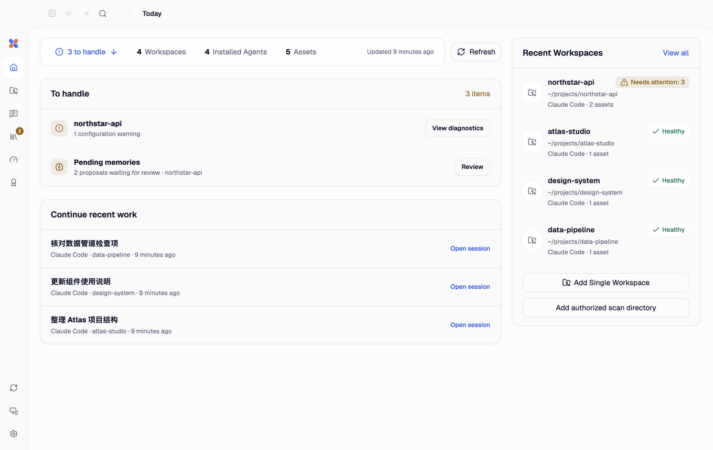

  

<h1 align="center">AgentKib</h1>

<strong>Find your coding conversations, pick up where you left off, and check in from your phone.</strong>

  <a href="https://github.com/starroyhq/agentkib/releases/latest"><strong>Download AgentKib</strong></a> ·
  <a href="https://agentkib.com">Website</a> ·
  <a href="README.zh-CN.md">简体中文</a>

AgentKib brings conversations from tools such as Codex and Claude Code into one desktop app. See which tasks are running, need your approval, or have finished. When an agent supports it, you can keep working in the same conversation.

## Download and install

| Your computer                 | Choose this installer                                                                                  |
| ----------------------------- | ------------------------------------------------------------------------------------------------------ |
| **Mac** (macOS 13.3 or later) | Choose the Apple silicon (`arm64`) or Intel (`x64`) `.dmg`. Open it and drag AgentKib to Applications. |
| **Windows 11**                | Run the `x64` `.exe`. The Windows ARM64 installer is a preview.                                        |
| **Linux**                     | Choose `.deb` or AppImage for Ubuntu 22.04, or `.rpm` for Fedora. Linux ARM64 packages are previews.   |

Download from the official release and check the matching `.sha256` file before installing. Mac releases are signed and notarized. Windows installers are currently unsigned, so SmartScreen may show a warning. If you already have AgentKib, use **Settings → General → Check for updates** or follow the [upgrade guide](docs/UPGRADING.md) for your package.

Packaged development builds can also check for stable releases.

After an update, AgentKib switches to the new version when you reopen it. When updating from 0.36.0 or later, eligible managed turns resume automatically after reopening.

The Windows release workflow can build an x64 MSIX for Microsoft Store submission. Store availability is pending.

## What’s new in 0.36.4

- **Security fix.** Restore workspace scope checks for legacy restricted pairings. Affected devices could read conversation lists and histories outside their authorized workspaces. If you still use a legacy pairing, update to 0.36.4.
- The backend retains specific failure reasons for stop, approval, answer, queue, attachment, and remote-read operations. Short explanations in the interface will follow in a later release. Confirmed managed Claude Code actions keep their receipts when a later status read fails, so they no longer appear as unexecuted.
- After a terminal Claude Code session is assigned as a Project Agent, terminal plugin 0.5.14 reports whether its tools are ready.

See the [changelog](CHANGELOG.md) for details.

## Get started

1. **Open AgentKib.** It looks for coding agents and projects already on your computer. If a project is missing, open **Workspaces → Add workspace** and choose its folder.
2. **Open Sessions.** Pick a project or filter by agent to find a conversation. Open it to read the history or continue it when the agent offers that option. To start fresh, choose **New session** and select an available agent.
3. **Connect your phone if you want remote access.** On your computer, open **Settings → Remote connections → Connect phone**. Scan the QR code, enter the pairing code, and use the AgentKib app or your browser. Keep AgentKib running on the computer. [Phone setup guide](docs/remote/phone-access.md)

If your default agent is missing, AgentKib can select an installed agent and keep your draft. [Installation and first use](docs/INSTALL.md#english)

_Example screen with demo data._

## What you can do

- **Resume work after quitting.** When you quit AgentKib, you can choose to resume eligible Codex, Claude Code, and DeepSeek Harness tasks the next time you open it. You can also pick up interrupted tasks yourself from Home. Status updates for Workers interrupted when you quit go directly to the Project Agent, even while delegation is paused. [Working with conversations](docs/sessions/conversations.md#退出后继续任务)
- **Paste or drop attachments.** Paste a screenshot or a copied file, drag files into the message box, or choose them with **+** in supported desktop and Web sessions. [Working with conversations](docs/sessions/conversations.md)
- **Manage follow-ups in one queue.** On desktop and Web, use the same controls to edit, remove, reorder, pause, resume, or send a queued message into the current turn where the agent supports it. Claude Code history shows messages added mid-turn in the order they were sent. [Working with conversations](docs/sessions/conversations.md)
- **Choose permissions before sending.** When you start a session, choose from the permissions the agent supports. Your choice applies to the first message. Managed Claude Code sessions use Claude Code’s own `allow` and `deny` rules. AgentKib reads the permission mode Claude Code reports at startup, including `auto`. If AgentKib can’t verify an existing Codex session’s permissions, you can choose an execution policy before continuing. [Working with conversations](docs/sessions/conversations.md)
- **Keep track of work across agents.** Browse conversations by project, pin the ones you need, and spot unread results. Pick up desktop drafts and search earlier conversations. Desktop **Settings → Sessions** groups options for sending follow-ups and picking up work after limits or quitting. [Working with conversations](docs/sessions/conversations.md) · [Search guide](docs/sessions/content-search.md)
- **Organize sessions from the sidebar.** Open the same action menu from the ellipsis or by right-clicking a session on desktop or Web. Rename connected Claude Code terminal sessions in AgentKib, including while they are running. [Working with conversations](docs/sessions/conversations.md)
- **See what is running in a conversation.** Open the floating **Session activity** panel to see background tasks and subagents in supported sessions, including connected Claude Code terminals. Open a subagent's history where available. Common controls such as search and new session now use icon buttons. [Working with conversations](docs/sessions/conversations.md)
- **Inspect tool calls.** Expand a tool row in place to see its command, output, or other available details. Execution details stay with the turn that ran them, and supported histories mark where the agent compacted context. The execution details heading lists the tools used. [Working with conversations](docs/sessions/conversations.md)
- **Take over from a question or approval card.** The redesigned question cards use the same layout for active and past questions. On desktop or paired Web, start a takeover directly from the card when a supported Claude Code session is held by a terminal. Paired Web explains why an action is unavailable in place. [Working with conversations](docs/sessions/conversations.md)
- **Review past questions and approvals.** Claude Code history shows terminal questions and answers and preserves separate assistant messages. Images you attached to an answer appear under the matching question. In desktop **Settings → Sessions → Security and approvals**, review recent decisions made in AgentKib and auto-allow rules, and revoke eligible Claude Code rules. [Working with conversations](docs/sessions/conversations.md)
- **Hand off a task.** If you want a different agent to take over, review the handoff first. The receiving agent can open it as a conversation or read a handoff file, depending on what it supports. [Handoff guide](docs/sessions/interoperability.md)
- **Coordinate several conversations.** On macOS, a supported conversation can become a Project Agent. Use **Assign Workers** to add up to 10 existing Codex, Claude Code, DeepSeek Harness, or Devin conversations. The Project Agent can give them tasks and restart supported Workers. For a running Codex Worker managed by AgentKib, it can also add instructions to the current turn or queue a follow-up. It receives combined completion reports and alerts about disconnects, usage limits, and possible stalls. Delegation keeps its state after AgentKib restarts. When a supported usage limit clears, queued reports arrive before delegation resumes. If a Worker report can’t reach the Project Agent, AgentKib retries automatically while delegation continues. [Project Agent guide](docs/agents/project-agent.md)
- **Pick up after a usage limit.** In supported sessions, see when the limit resets and whether the session can resume automatically. [Usage limits](docs/agents/usage-limits.md)
- **Manage the tools your agents use.** Check which instructions and Skills a project sees, organize reusable Skills, and manage connections to external tools through MCP. Review proposed configuration changes before applying them. [Skills guide](docs/library/skills.md) · [MCP guide](docs/library/mcp.md)

When a terminal closes, AgentKib automatically takes over eligible Claude Code Project Agents with work or reports still pending. You can also continue eligible Claude Code sessions with long histories by sending directly from AgentKib after closing the terminal. The Worker picker can show available sessions even when one check is slow. [Project Agent guide](docs/agents/project-agent.md)

The Project Agent can inspect Worker settings and change the model, reasoning effort, or speed tier on supported idle Workers. After switching to a Codex account with available quota, eligible Workers can accept tasks again automatically. Stall alerts after a restart follow progress in the current turn. When a managed Codex Worker appears stuck, AgentKib automatically checks the native log for a missed turn-end event. The Project Agent can also restart that Worker. AgentKib removes the limit on simultaneous sessions, and the Project Agent warns you when the machine is under strain. [Project Agent guide](docs/agents/project-agent.md)

Worker activity updates the affected rows in the session list, reducing backend load as Workers write to their histories. Large histories and content search use bounded reads, including for DeepSeek Harness, Devin, and Antigravity. Live status checks continue while a message is being sent. Conversation pages refresh automatically, and AgentKib checks unconfirmed actions in the background. Session, workspace, usage, library, remote connection, and settings screens use shorter status messages.

The desktop session list retries once if loading times out. If it still cannot load, it shows the reason and lets you retry.

## Which agents work with AgentKib?

- **Codex** supports starting and continuing conversations. On macOS, AgentKib can take over eligible conversations that aren’t open in the Codex app. [Codex guide](docs/agents/codex-managed.md)
- **Claude Code** can run in AgentKib or connect from a supported macOS terminal. View terminal approval requests and questions as read-only, get notifications on iPhone, and move eligible sessions into AgentKib from a paired device. When AgentKib detects Claude Code on macOS, it installs the bundled bridge plugin for the current user by default. Run `/agentkib-status` in the terminal for connection details. [Claude Code terminal guide](docs/agents/claude-code-terminal.md)
- **Devin** can start, continue, and control sessions through a supported CLI's ACP connection and can serve as a Project Agent. Usage checks read the full result. [Devin guide](docs/agents/devin.md)
- **Antigravity** lets you read local app and IDE history and import it into supported agents, with ACP control and delegation disabled under Google's terms for personal accounts. [Antigravity guide](docs/agents/antigravity.md)
- **DeepSeek Harness** is in beta on macOS. Import reviewed history from supported agents into a new session and preview images in DSH history. AgentKib starts a compatible DSH automatically when you create or continue a session that needs it. [DeepSeek Harness guide](docs/agents/deepseek-harness.md)

You can also browse available local history from Cursor, OpenCode, OpenClaw, Hermes, and Grok Build. See the [compatibility guide](docs/FEATURES.md) for your agent and platform.

## Accounts and privacy

Reading local history needs no AgentKib account and makes no model calls. Sending a message uses your agent's own sign-in, permissions, and usage limits.

Remote access is off by default. When you pair a device, choose read-only access or full control and revoke it from the desktop whenever you want. The official remote service uses an AgentKib account. [Local Wi-Fi access](docs/remote/hosted-web-lan.md) can be set up without an account on a trusted network.

If phone pairing fails, AgentKib shows the reason and what you can do next. [Phone setup guide](docs/remote/phone-access.md)

To keep phone access responsive, the host limits live connections, connection checks, and ordinary requests separately and tells the phone how long to wait if it hits a limit. [Phone access guide](docs/remote/phone-access.md)

With a compatible iPhone app, you can act on supported approvals from a lock-screen notification. In **Settings → Sessions → Notifications**, choose which alerts to get, set quiet hours, or get alerts only while away from the computer. [Phone notifications](docs/remote/phone-access.md#手机通知)

Session titles in iPhone Live Activity updates are shared only in the encrypted payload. [Phone access guide](docs/remote/phone-access.md)

On a compatible paired phone, follow plan progress in supported sessions, see a turn summary of files changed and checks run, and expand unchanged lines in Git diffs. [Phone access guide](docs/remote/phone-access.md)

AgentKib prompts you when your desktop sign-in expires. Choose **Sign in again** in Remote connections or the menu bar. Signing back in to the same account automatically restores the official relay if it was on.

## Help

To investigate a slow backend, use **Settings → Diagnostics → Export diagnostics** to export recent stalls and a trace summary.

[FAQ](docs/FAQ.md#english) · [User guides](docs/README.md) (mostly in Chinese) · [Release notes](https://github.com/starroyhq/agentkib/releases) · [Report an issue](https://github.com/starroyhq/agentkib/issues) · [Report a security issue privately](SECURITY.md)

For source builds and tests, see the [development guide](docs/DEVELOPMENT.md). AgentKib is open source under the [Apache License 2.0](LICENSE).
