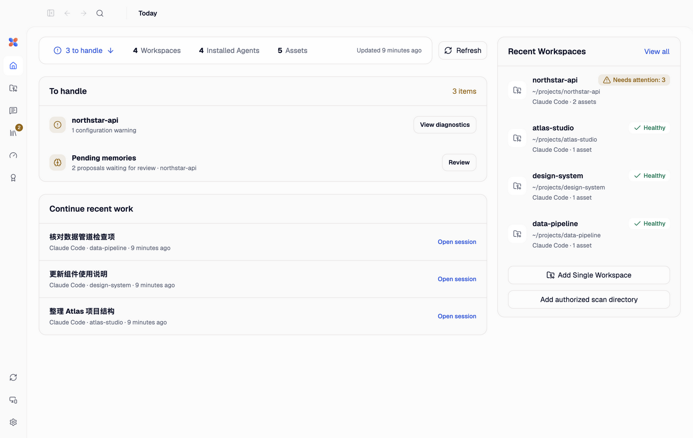

  

<h1 align="center">AgentKib</h1>

<strong>One local app for your coding agents: their sessions, handoffs, remote control, context, Skills, MCP services and tools.</strong>

  <a href="https://agentkib.com">Website</a> ·
  <a href="https://github.com/starroyhq/agentkib/releases/latest">Download</a> ·
  <a href="docs/README.md">Documentation</a> ·
  <a href="README.zh-CN.md">简体中文</a>

  
  
  
  

AgentKib brings the coding agents on your computer into one desktop app: Codex, Claude Code, Cursor, OpenCode, Antigravity, OpenClaw, Hermes, Grok Build and DeepSeek Harness. Read and continue their sessions, hand a conversation from one agent to another, follow and control your sessions from a phone, and keep instructions, Skills, MCP services and the agent CLIs themselves in order.

Everything runs on your computer. Discovery, diagnostics, history and handoff need no AgentKib account and no model API; an account is only used for the optional remote relay. **KIB** stands for **Knowledge & Instruction Base**.

## What you can do

### Work with every agent's sessions

- One session directory for all supported agents, grouped by workspace and by git repository, worktrees included. Opt-in full-text search covers the sessions on this computer.
- Keep working in Codex, Claude Code and Antigravity sessions without leaving AgentKib: send messages, answer approvals and questions, and, where the agent supports it, add attachments, switch model and reasoning effort, plan, run slash commands, queue messages and set goals. In Codex and Claude Code sessions, commands show their output, file edits show a diff, and each turn shows how long it took.
- Connect a session that is already running instead of starting a second copy (macOS): a Claude Code terminal through the AgentKib plugin, a Codex Desktop session, or DeepSeek Harness through its bridge plugin.
- Unread results stay in sync between the desktop, Web and phone.

### Hand a session to another agent

- Turn a session into a reviewed handoff for another agent. Codex and Claude Code take it as a native session they can resume; OpenCode, Hermes, OpenClaw and connected Cursor IDE windows have experimental native imports. Any agent can start from a handoff file instead, and DeepSeek Harness opens it in a new session.
- Common secrets are redacted, anything the target cannot keep is listed for you to accept, and nothing is written before you approve the change.

### Use your computer from your phone

- Use the AgentKib phone app, or a browser on your phone or another computer. Pair it with an 8-character code and give it read-only access or full control.
- Connect through the AgentKib Remote relay with an [AgentKib account](https://account.agentkib.com), directly over your local network, or through your own HTTPS setup. On the same network the phone app connects to the computer directly by itself. When the app and the computer are signed in to the same account, the pairing renews while the app stays signed in and ends when it signs out.
- Full control covers sending, approvals and questions, attachments, project files and artifacts, and a preview of web pages running on the computer. Tasks keep running when the phone disconnects; the desktop app has to stay open.

### Keep context, Skills and MCP in order

- See which instructions, Skills, MCP servers, memory and settings each agent loads in a workspace, diagnose missing, drifted or duplicated assets, and review every change as a complete diff before it is written.
- Skill library: reviewed OpenAI Skills and GitHub packages pinned to a commit, import from the agents you already use, and deploy to personal or project locations with update, rollback and withdrawal.
- MCP Hub: collect MCP servers once, connect them to your installed agents, and choose which tools each agent gets.

### Maintain the toolchain

- Versions, install sources and PATH conflicts of every agent CLI, with updates pinned to an exact version where the package manager allows it.
- Quota windows, plus API-price estimates from local Codex and Claude Code logs, and usage insights derived on your machine.

## Supported agents

| Agent | Sessions | Continue in AgentKib | Native handoff target | Context and Skills | Tool updates |
| --- | --- | --- | --- | --- | --- |
| Codex | Yes | Yes; follows Codex Desktop on macOS | Yes | Yes | Yes |
| Claude Code | Yes | macOS, in AgentKib or a connected terminal | Yes | Yes (context partly) | Yes |
| Antigravity | [App/IDE (read-only)](docs/agents/antigravity.md) and ACP sessions | Through the official ACP server | — | Yes | Install guide only |
| Cursor | CLI and connected IDE (macOS) | — | IDE, experimental | Yes | Yes |
| OpenCode | Yes | — | Experimental | Yes | Yes |
| OpenClaw | Read-only | — | Experimental | Yes | Yes |
| Hermes | Read-only | — | Experimental | Yes | Yes |
| Grok Build | Read-only | — | — | Yes | Yes |
| DeepSeek Harness (beta) | Through a running DSH (macOS) | Through its bridge plugin (macOS) | Handoff file | Diagnostics only | — |

DeepSeek Harness support is in development and not yet part of a release. Version requirements and the limits of each capability are in the [feature and compatibility matrix](docs/FEATURES.md) and the [session handoff matrix](docs/sessions/interoperability.md).

## Download

Download the current release from [Releases](https://github.com/starroyhq/agentkib/releases/latest):

- macOS 13.3 or later: `.dmg` for Apple Silicon or Intel, signed and notarized.
- Windows 11: x64 `.exe`; ARM64 is a preview.
- Linux: `.deb` or AppImage for Ubuntu 22.04, `.rpm` for Fedora; ARM64 is a preview.

Use only files from the official release and check them against the matching `.sha256` file. Windows installers are not Authenticode-signed yet, so SmartScreen may warn. In-app updates and per-package upgrade notes are in the [upgrade guide](docs/UPGRADING.md).

The interface is available in English, Simplified Chinese, Traditional Chinese and Japanese, with light, dark and system themes.

## Privacy and safety

- Discovery, diagnostics and history reading stay on your computer. They do not call a model or upload project files.
- Credentials, cookies, tokens, private keys and environment files are never cataloged as assets or written to logs.
- AgentKib runs your own agent CLIs, which keep their own sign-in. It does not read or copy their login credentials.
- Quota collection is separate: a bundled third-party collector (CodexBar) runs only when you refresh quotas or turn on automatic collection, and it may read provider credentials such as Claude browser cookies. See [quota collection and credentials](docs/FEATURES.md#across-your-machine).
- Every write is a change you review first, with backups and checks that the files did not change in between. Writes to an agent's home folder need a separate confirmation.
- Remote access is off until you turn it on. Each paired device has its own access level and can be revoked from the desktop.

## Documentation

- [Documentation index](docs/README.md): sessions, agent integrations, remote access, Skills, MCP and development. Most documents are in Chinese.
- [Feature and compatibility matrix](docs/FEATURES.md)
- [Upgrade guide](docs/UPGRADING.md)
- [Development guide](docs/DEVELOPMENT.md)
- [Contributing](CONTRIBUTING.md) · [Security policy](SECURITY.md) · [Third-party notices](THIRD_PARTY_NOTICES.md) · [GitHub Issues](https://github.com/starroyhq/agentkib/issues)

Report security vulnerabilities privately as described in the [security policy](SECURITY.md), not in a public issue. AgentKib is released under the [Apache License 2.0](LICENSE).
