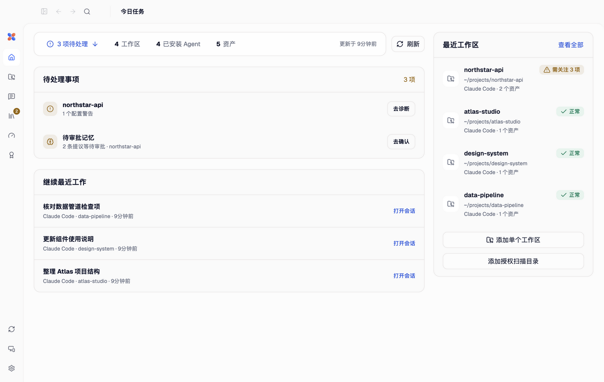

  

<h1 align="center">AgentKib</h1>

<strong>在一处找到你的 AI 编程会话，接着上次继续，也能用手机跟进。</strong>

  <a href="https://github.com/starroyhq/agentkib/releases/latest"><strong>下载 AgentKib</strong></a> ·
  <a href="https://agentkib.com">官网</a> ·
  <a href="README.md">English</a>

AgentKib 把 Codex、Claude Code 等工具的会话放进同一个桌面应用。在这里就能看到哪些任务还在运行、哪些在等你批准、哪些已经完成。Agent 支持时，你可以直接在原会话里继续工作。

## 下载和安装

| 你的电脑                         | 选这个安装包                                                                                   |
| -------------------------------- | ---------------------------------------------------------------------------------------------- |
| **Mac**（macOS 13.3 或更新版本） | 下载 Apple 芯片（`arm64`）或 Intel（`x64`）对应的 `.dmg`，打开后把 AgentKib 拖到「应用程序」。 |
| **Windows 11**                   | 运行 `x64` 的 `.exe` 安装包。Windows ARM64 安装包为预览版。                                    |
| **Linux**                        | Ubuntu 22.04 选 `.deb` 或 AppImage，Fedora 选 `.rpm`。Linux ARM64 安装包为预览版。             |

请从官方发布页下载并核对对应的 `.sha256` 校验文件。Mac 正式包已签名并经 Apple 公证。Windows 安装包目前未签名，SmartScreen 可能弹出提示。已安装 AgentKib 的用户可在「设置 → 常规 → 检查更新」检查新版，各安装包的更新方式见[升级指南](docs/UPGRADING.md)。

## 第一次使用

1. **打开 AgentKib。** 它会查找电脑上已有的 Agent 和项目。找不到项目时，到「工作区 → 添加工作区」选择项目文件夹。
2. **进入「会话」。** 按项目或 Agent 找到之前的对话，打开就能查看记录。支持继续的会话可以直接发消息。要另开一段对话，选择「新建会话」和可用的 Agent。
3. **想用手机跟进时再配对。** 在电脑上打开「设置 → 远程连接 → 连接手机」，用 AgentKib 手机 App 或浏览器扫码并输入授权码。请让电脑上的 AgentKib 保持运行。[手机访问指南](docs/remote/phone-access.md)

_界面示例使用演示数据。_

## 能做什么

- **退出后接着做。** 退出 AgentKib 时，可选择下次打开后继续符合条件的 Codex、Claude Code 和 DeepSeek Harness 任务，也可在首页手动继续因退出而中断的任务。退出后被打断的 Worker 状态会直接告诉项目 Agent，委派暂停时也照常送达。[会话使用指南](docs/sessions/conversations.md#退出后继续任务)
- **粘贴或拖放附件。** 在支持附件的桌面和 Web 会话中，可以粘贴截图或复制的文件，把文件拖进输入框，或用「+」选择文件。[会话使用指南](docs/sessions/conversations.md)
- **在同一个队列里安排后续消息。** 桌面和 Web 使用相同的待发队列控件。根据 Agent 提供的能力，可以编辑、删除、调序、暂停、恢复，或把待发消息加入本轮。[会话使用指南](docs/sessions/conversations.md)
- **发送首条消息前选权限。** 新建会话时可选择 Agent 支持的权限，所选权限从首条消息开始生效。[会话使用指南](docs/sessions/conversations.md)
- **跟进多个 Agent 的工作。** 按项目浏览会话，置顶常用会话，查看未读结果。可以在桌面接着写草稿，也可以搜索以往的对话。桌面「设置 → 会话」集中管理后续消息的发送方式、用量限额后继续和退出后继续。[会话使用指南](docs/sessions/conversations.md) · [正文搜索指南](docs/sessions/content-search.md)
- **查看会话里正在运行的工作。** 打开「会话活动」浮窗，可查看支持会话里的后台任务和子代理，包括已连接的 Claude Code 终端。支持时可打开子代理的历史记录。搜索、新建会话等常用控件改为纯图标按钮。[会话使用指南](docs/sessions/conversations.md)
- **查看以往的提问和审批。** 支持的会话历史会显示问题和回答卡片。在 Claude Code 历史中，你作答时添加的图片会显示在对应问题下。在桌面「设置 → 会话 → 安全与审批」可查看近期通过 AgentKib 作出的决定和自动允许规则，并撤销符合条件的 Claude Code 规则。[会话使用指南](docs/sessions/conversations.md)
- **换一个 Agent 接着做。** 先审查交接内容，再交给另一个 Agent。对方可以直接打开会话，或读取交接文件，具体取决于它支持的方式。[会话交接指南](docs/sessions/interoperability.md)
- **让一个会话协调多项任务。** 在 macOS 上，可以将支持的会话设为项目 Agent，用「指派 Worker」加入最多 10 个已有的 Codex、Claude Code、DeepSeek Harness、Devin 或 Antigravity 会话。项目 Agent 可以分配任务，重启支持的 Worker。由 AgentKib 运行的 Codex Worker 忙时，项目 Agent 还可向当前轮次追加指令，或把后续消息加入队列。它会收到合并的完成汇报，以及断线、用量上限和疑似卡住的提醒。[项目 Agent 指南](docs/agents/project-agent.md)
- **达到用量上限后继续。** 在支持的会话中，可以查看额度何时重置、会话是否会自动继续。[用量上限说明](docs/agents/usage-limits.md)
- **管好 Agent 能用的工具。** 查看项目里的指令和 Skills，整理可复用的 Skills，通过 MCP 管理外部工具连接。应用设置改动前，可以先查看将要更改的内容。[Skills 管理](docs/library/skills.md) · [MCP 管理](docs/library/mcp.md)

桌面会话目录加载超时会自动重试一次，仍无法加载时会说明原因，并提供手动重试入口。

## 支持哪些 Agent？

- **Codex** 支持新建和继续会话。在 macOS 上，AgentKib 可以接手符合条件且未在 Codex 应用中打开的会话。[Codex 指南](docs/agents/codex-managed.md)
- **Claude Code** 可以由 AgentKib 运行，也可以从 macOS 上支持的终端连接。终端的审批和提问可只读查看并推送到 iPhone，配对设备可以把符合条件的会话转到 AgentKib 继续。AgentKib 会自动更新由它提供且已安装的桥接插件。在终端输入 `/agentkib-status` 可查看连接详情。[Claude Code 终端指南](docs/agents/claude-code-terminal.md)
- **Devin 和 Antigravity** 可通过受支持 CLI 的 ACP 连接新建、继续和控制会话，也可以担任项目 Agent。Antigravity 还提供应用和 IDE 的只读历史，会保留能读到的记录，并说明哪些来源暂不可读。[Devin 指南](docs/agents/devin.md) · [Antigravity 指南](docs/agents/antigravity.md)
- **DeepSeek Harness** 在 macOS 上提供 Beta 支持。可以将支持的 Agent 的历史审查后导入新会话，也可以预览 DSH 历史中的图片。新建或继续会话时如有需要，AgentKib 会自动启动兼容的 DSH。[DeepSeek Harness 指南](docs/agents/deepseek-harness.md)

Cursor、OpenCode、OpenClaw、Hermes 和 Grok Build 也可查看本机已有的会话记录。各 Agent 和平台的具体能力见[兼容性说明](docs/FEATURES.md)。

## 账号与隐私

查看本机会话记录无需 AgentKib 账号，也不会调用模型。发送消息时沿用所用 Agent 的登录状态、权限和额度。

远程访问默认关闭。配对时可为设备选择只读或完整控制，也可以随时从桌面撤销。使用官方远程服务需要 AgentKib 账号。在可信的同一 Wi-Fi 网络上，可选择[局域网直连](docs/remote/hosted-web-lan.md)，无需登录。

手机配对失败时会显示具体原因和下一步。[手机访问指南](docs/remote/phone-access.md)

## 帮助

[使用文档](docs/README.md) · [版本更新记录](https://github.com/starroyhq/agentkib/releases) · [反馈问题](https://github.com/starroyhq/agentkib/issues) · [私下报告安全问题](SECURITY.md)

源码构建与测试请查阅[开发文档](docs/DEVELOPMENT.md)。AgentKib 使用 [Apache License 2.0](LICENSE) 开源。
