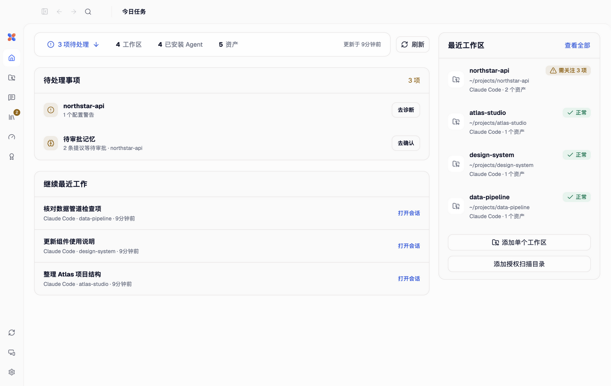

  

<h1 align="center">AgentKib</h1>

<strong>一个本地应用，管好你的 Coding Agent：会话、交接、远程操控、上下文、Skills、MCP 服务与工具链。</strong>

  <a href="https://agentkib.com">官网</a> ·
  <a href="https://github.com/starroyhq/agentkib/releases/latest">下载</a> ·
  <a href="docs/README.md">文档</a> ·
  <a href="README.md">English</a>

  
  
  
  

AgentKib 把电脑上的 Coding Agent 汇集到一个桌面应用里：Codex、Claude Code、Cursor、OpenCode、Antigravity、OpenClaw、Hermes、Grok Build、DeepSeek Harness 和 Devin。你可以查看并继续它们的会话，把对话从一个 Agent 交给另一个，在手机上跟进和操控会话，并维护指令、Skills、MCP 服务以及各 Agent 的 CLI 本身。

所有处理都在你的电脑上进行。发现、诊断、历史阅读和交接不需要 AgentKib 账号，也不需要模型 API；账号只用于可选的远程中继。**KIB** 代表 **Knowledge & Instruction Base（知识与指令底座）**。

## 能做什么

### 统一查看和继续各 Agent 的会话

- 所有受支持 Agent 的会话放在同一个目录里，按工作区和 git 仓库分组，工作树也归入所属仓库。可选开启正文搜索，搜索这台电脑上的会话。
- 不离开 AgentKib 就能继续 Codex、Claude Code 和 Antigravity 的会话：发送消息、处理审批和问题；Agent 支持时还可以添加附件、切换模型和思考强度、使用计划模式和斜杠命令、排队消息和设定目标。Codex 和 Claude Code 会话里，命令显示输出，文件改动显示差异，每轮显示用时。
- 已经在运行的会话可以直接连接，不另起一份（macOS）：通过 AgentKib 插件连接 Claude Code 终端，跟随 Codex 桌面端，或通过桥接插件连接 DeepSeek Harness。
- 未读结果在桌面、Web 和手机之间同步。

### 把会话交给另一个 Agent

- 把会话生成经过审查的交接内容，交给另一个 Agent。Codex 和 Claude Code 以原生会话接收，可以直接恢复；OpenCode、Hermes、OpenClaw 和已连接的 Cursor IDE 窗口支持实验性的原生导入。任何 Agent 都可以改用交接文件开始，DeepSeek Harness 会新建一个会话读取它。
- 常见敏感值会被遮盖，目标无法保留的内容会列出来请你确认，批准之前不写入任何东西。

### 在手机上使用电脑

- 使用 AgentKib 手机 App，或手机、其他电脑上的浏览器，用八位授权码配对，按设备授予只读或完整控制。
- 可以登录 [AgentKib 账号](https://account.agentkib.com)经官方中继连接，也可以在局域网内直连，或使用自己配置的 HTTPS。手机 App 在同一网络里会自动改为直连电脑；App 与电脑登录同一账号时，配对随 App 的登录自动续期，App 退出登录后电脑收回授权。
- 完整控制包括发送、审批和问答、附件、项目文件与产物，以及预览电脑上正在运行的网页。手机断开后任务继续运行；桌面应用需要保持打开。

### 维护上下文、Skills 和 MCP

- 查看每个 Agent 在工作区里实际加载的指令、Skills、MCP 服务、记忆和设置，诊断缺失、漂移或重复的资产；所有改动先以完整差异供你审查，确认后才写入。
- Skill 库：经过审查的 OpenAI Skills 和固定到 Commit 的 GitHub 包，可以从已在用的 Agent 导入，部署到个人或项目位置，并支持更新、回滚和撤销。
- MCP Hub：MCP 服务只需收录一次，即可接入已安装的各个 Agent，并按 Agent 选择开放哪些工具。

### 维护工具链

- 显示每个 Agent CLI 的版本、安装来源和 PATH 冲突；包管理器支持时，按精确版本更新。
- 额度窗口，以及根据本机 Codex 和 Claude Code 日志按 API 价格估算的费用，还有在本机统计的用量洞察。

## 支持的 Agent

| Agent | 会话 | 在 AgentKib 中继续 | 原生交接目标 | 上下文与 Skills | 工具更新 |
| --- | --- | --- | --- | --- | --- |
| Codex | 支持 | 支持；macOS 上可跟随 Codex 桌面端 | 支持 | 支持 | 支持 |
| Claude Code | 支持 | macOS，在 AgentKib 中或连接终端 | 支持 | 支持（上下文部分支持） | 支持 |
| Antigravity | ACP 会话 | 经官方 ACP 服务 | — | 支持 | 仅提供安装说明 |
| Cursor | CLI 与已连接的 IDE（macOS） | — | IDE，实验性 | 支持 | 支持 |
| OpenCode | 支持 | — | 实验性 | 支持 | 支持 |
| OpenClaw | 只读 | — | 实验性 | 支持 | 支持 |
| Hermes | 只读 | — | 实验性 | 支持 | 支持 |
| Grok Build | 只读 | — | — | 支持 | 支持 |
| Devin | 只读，含 CLI 与 Desktop | — | 交接文件 | 支持 | 检测 / 官方安装器 |
| DeepSeek Harness（Beta） | 经运行中的 DSH（macOS） | 经桥接插件（macOS） | 交接文件 | 仅诊断 | — |

DeepSeek Harness 支持仍在开发中，尚未包含在正式版里。各项能力的版本要求和限制见[功能与兼容矩阵](docs/FEATURES.md)和[会话互通矩阵](docs/sessions/interoperability.md)。

## 下载

从 [Releases](https://github.com/starroyhq/agentkib/releases/latest) 下载当前版本：

- macOS 13.3 及以上：Apple Silicon 或 Intel 的 `.dmg`，已签名并公证。
- Windows 11：x64 `.exe`；ARM64 为预览版。
- Linux：Ubuntu 22.04 的 `.deb` 或 AppImage，Fedora 的 `.rpm`；ARM64 为预览版。

请只使用官方 Release 中的文件，并用对应的 `.sha256` 文件核对。Windows 安装包尚未进行 Authenticode 签名，SmartScreen 可能提示风险。应用内更新和各安装包的升级说明见[升级指南](docs/UPGRADING.md)。

界面支持 English、简体中文、繁體中文和日本語，提供浅色、深色和跟随系统三种主题。

## 隐私与安全

- 发现、诊断和历史阅读都在你的电脑上完成，不调用模型，也不上传项目文件。
- 凭据、Cookie、Token、私钥和环境文件不会被收录为资产，也不会写入日志。
- AgentKib 运行的是你本机的 Agent CLI，沿用它们自己的登录状态，不读取或复制它们的登录凭据。
- 额度采集是另一条路径：随应用打包的第三方采集器（CodexBar）只在你刷新额度或开启自动获取后运行，它可能读取各服务的凭据，例如 Claude 的浏览器 Cookie。详见[额度采集与凭据](docs/agents/claude-code-managed.md#额度采集与凭据)。
- 每次写入都先生成改动供你审查，写入时创建备份，并核对文件在此期间没有被改过。写入 Agent 的 Home 目录需要单独确认。
- 远程访问默认关闭。每台配对设备有自己的权限档位，可以随时在桌面上撤销。

## 文档

- [文档目录](docs/README.md)：会话、Agent 接入、远程访问、Skills、MCP 和开发相关文档。
- [功能与兼容矩阵](docs/FEATURES.md)
- [升级指南](docs/UPGRADING.md)
- [开发文档](docs/DEVELOPMENT.md)
- [贡献指南](CONTRIBUTING.md) · [安全策略](SECURITY.md) · [第三方许可](THIRD_PARTY_NOTICES.md) · [GitHub Issues](https://github.com/starroyhq/agentkib/issues)

安全漏洞请按照[安全策略](SECURITY.md)私下报告，不要创建公开 Issue。AgentKib 使用 [Apache License 2.0](LICENSE) 发布。
