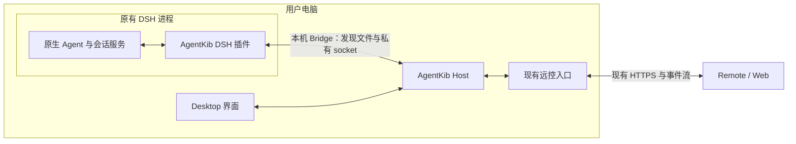

# DeepSeek Harness 接入方案草案

状态：一期与二期 2a、2b、2c 已实施并合并（#199、#201、#204），2d 已实施；2026-11-08 确认先以 DSH 打开时可用为准，三期暂缓。日期：2026-11-04；同日按 DSH、AgentKib 与 agentkib-flutter 源码复核修订，并按“完全接管”目标重排分期。

本文记录宿主机插件桥接、Remote 复用现有链路，以及后续 CLI 与 Desktop 共用实例的接入方向。文中的新命令、模块和协议字段均为建议，不代表当前已提供的功能。

## 1. 目标与结论

目标是让 AgentKib 完全接管 DeepSeek Harness（下文简称 DSH）的会话：在 Desktop、Web 和手机上完成 DSH 原生界面对会话能做的全部操作，包括作答审批和问答；DSH 未运行时由 AgentKib 启动它继续。DSH 原生界面保留可用，两边看到同一状态，交互请求先答者生效。

实现方式是在用户电脑上运行的 DSH 中安装 AgentKib 插件。插件连接本机的 AgentKib Host，将原生会话的历史、状态、交互和控制能力接入 AgentKib。Desktop、Web 和 Remote 操作同一逻辑 Host，手机继续使用 AgentKib 的远控协议。

建议采用以下分工：

- DSH 继续负责模型调用、工具执行、原生权限、会话日志和写入所有权。
- AgentKib Host 负责会话映射、统一事件投影、设备授权、控制调度和持久回执。
- DSH 插件负责原生能力适配，优先调用 DSH 自带的会话服务，通过本机 Bridge 与 Host 双向通信。
- Bridge 在 Claude 原会话连接已有的本机发现、私有 socket、绑定和 lease 机制上扩展为多来源，不另建一套连接库。
- Remote 不在手机上安装或运行 DSH，不直接连接 DSH Web API，也不引入 DSH Remote 的账号和网络通道；需要启动 DSH 时由宿主机完成（三期）。

一期保留当前 Desktop 对 Host 的承载方式。Desktop 在运行或托盘常驻时，插件和 Remote 均连接这个实例。CLI 接入与独立无界面 Host 作为后续演进，不与基本 DSH 接入绑定实施。

分期概览（详见 §7）：

| 阶段 | 交付                                                                                | 完成后用户能做什么                                              |
| ---- | ----------------------------------------------------------------------------------- | --------------------------------------------------------------- |
| 一期 | Bridge、插件、会话接入、发送与队列、停止、审批与问答作答、在运行中的 DSH 内恢复会话 | DSH 开着时，在任何设备上继续任意 DSH 会话，不会卡在审批或问答上 |
| 二期 | 模型与 preset、附件、重命名、分叉、归档、目标、新建会话、子代理、跨 Agent 交接      | 会话管理与设置和 DSH 原生界面对齐                               |
| 三期 | DSH 未运行时由 AgentKib 启动并托管                                                  | 不需要先打开 DSH                                                |
| 四期 | 独立常驻 Host 与 CLI 接入                                                           | Desktop 关闭后仍可远控                                          |

一期平台限定 macOS，控制限定 DSH 的 web 与 desktop profile。分期理由：一期先打通“继续会话”的完整闭环，审批和问答必须在一期作答，否则 DSH 界面没打开时会话会一直停在等待中；二期补齐会话管理；三期去掉“必须先打开 DSH”的前提；四期解决 Desktop 退出后的远控。

### 1.1 产品边界变更（2026-11-04 已确认）

现有文档承诺 DSH 是只读 Beta：[功能说明](FEATURES.md)写明 DSH “is never written to”，[会话互操作说明](SESSION-INTEROPERABILITY.md)写明 DSH “不参与新增续接或原生写入”。2026-11-04 确认需要完全接管，接受以下变更：

- 安装插件会写入用户的 DSH profile，包括 `package.json`、锁文件和组合包列表。
- 发送、停止、作答审批和问答、修改会话设置等操作会写入原生会话。
- 三期由 AgentKib 启动和停止 DSH 进程。

一期上线时同步更新上述两份文档和支持矩阵（一期工作树已更新，另含[实时会话](CONVERSATIONS.md)与[界面术语](UI-TERMINOLOGY.md)）。插件安装沿用 Claude 原会话连接的做法：AgentKib 只提供插件包、命令和说明，由用户自行执行，不自动修改 DSH profile。

## 2. 当前代码事实

| 范围              | 已核对的现状                                                                                                                                               | 对方案的影响                                                                                          |
| ----------------- | ---------------------------------------------------------------------------------------------------------------------------------------------------------- | ----------------------------------------------------------------------------------------------------- |
| AgentKib CLI      | 只提供 scan、context、plan、validate、manifest；每次启动独立 backend 和临时数据目录，退出后清理；只是仓库脚本 `pnpm agentkib`，不随桌面安装包分发          | 不能直接复用作共享实例入口；作为用户入口需先解决分发，四期再评估                                      |
| Desktop Host      | Electron main 组合 runtime、ConversationHub、WebAccessService、账号及 Relay                                                                                | 一期可以继续由现有桌面进程组合承载                                                                    |
| 现有会话客户端    | Desktop IPC 与远程 HTTP／SSE 已共用会话服务、控制栅栏和回执路径；`/managed/*` 管理接口只接受 Codex、Claude Code                                            | DSH 应接入这套服务，不另外开放手机专用控制链路；接口需改为按来源能力路由（§8.1）                      |
| Claude 原会话连接 | 已有插件、0600 发现文件（每次 Runtime 启动更换密钥）、私有 Unix socket、持久绑定、在线 lease、事件同步和控制账本；仅 macOS；审批和问答仍在终端处理         | Bridge 在此基础上扩展为多来源，平台与其对齐；DSH 需要作答审批和问答，超出其交互范围，按 §5.4 单独设计 |
| DSH 支持范围      | 当前仅发现、上下文及部分只读诊断；产品文档承诺只读、不写入                                                                                                 | 需要新增 provider、能力投影和各端接线；产品边界变更已确认（§1.1）                                     |
| 各端会话状态      | Web 对 `codex-follower` 单独显示已连接；agentkib-flutter 把 `executionLocation: external` 一律视为被占用，并在多处写死只有 Codex、Claude Code 可用高级控制 | 需要不分来源的跟随状态和按 Host 能力的控制判断（§8.1）                                                |
| DSH 扩展          | Cordis 插件可访问原生 Agent、会话查询、生命周期事件和交互 waterfall                                                                                        | 已运行会话可通过进程内插件接入，无需为此启动第二个 SDK／ACP 进程                                      |
| DSH 会话服务      | web-app 组合包提供 `sessionController`：`prompt` 按 requestId 去重并把它记在消息上，统一处理附件准入、冷会话恢复和写入占用；`cancel` 保留待发队列          | 插件优先调用该服务，不直接调用 Agent 底层方法（§4.1）                                                 |
| DSH 交互转发      | DSH 自身界面经 `api-remotes` 挂在同一 waterfall 上；没有在线客户端时请求挂起等待；`next()` 不能改写下游请求                                                | 直接调用 `next()` 无法与原生界面共存作答，需按 §5.4 重新派发                                          |
| DSH 插件安装      | 插件以组合包形式安装到具体 profile；`dsh plugin add` 后须重启 profile 才生效；DSH Desktop 与 npm CLI 共享会话数据                                          | 首次接入需重启 DSH；同一会话可能出现在多个 DSH 进程中（§3.3、§5.1）                                   |
| DSH 启动参数      | `dsh --profile web --no-open --port 0 --host <本机地址>` 可不打开浏览器、在系统分配的端口上启动 web runtime                                                | 三期托管启动的基础（§4.2）                                                                            |

DSH 源码核对基线为本机 `/tmp/deepseek-harness`，commit `8bd073392eef6f54e921a093b95076248eb08cbb`，CLI 版本 `0.2.2-alpha.3`。公开 API 处于预稳定阶段，正式实施需明确支持版本、profile 和能力范围；本文不宣称已完成运行验证。

AgentKib 按 `main`（`cd391c228`，v0.26.0）复核；agentkib-flutter 按 `main`（`2c14526`）核对。

## 3. 目标架构

Host 表示一个逻辑实例，不要求所有模块处于同一个操作系统进程。当前 Electron main 与 utility backend 已分工承载这些职责。

网络通道继续传输 AgentKib 请求和事件。宿主机仍执行权限检查、DSH 协议适配与统一状态投影，不向手机开放原始 DSH RPC 或任意内部 backend 方法。

### 3.1 DSH 插件是能力提供方

插件向 Host 注册自己所在的 DSH runtime 及其会话，提供真实的历史、状态和原生动作。它不通过调用 AgentKib 的普通发送接口形成递归转发，也不把自己声明成拥有全部管理权限的 Desktop 客户端。

插件只处理经过绑定和授权、指向当前 DSH 实例的命令。没有对应能力时明确拒绝；不会伪造原生成功状态、直接改写日志或启动另一条会话替代原目标。

### 3.2 本机 Bridge 与 CLI

Bridge 沿用 Claude 原会话连接的机制：只允许当前用户读写的发现文件、每次 Runtime 启动更换的密钥、私有 Unix socket、控制账本与回执。DSH 插件运行在 DSH 的 Node 进程内，可以直接连接 Host，不需要外部转发进程。

实施时（2026-11-04）没有把 1800 多行的 Claude Bridge 改造成多来源，而是新建 `packages/backend/src/dsh-bridge.ts`，复用同一套做法和账本函数，使用自己的 socket（`/tmp/akdsh-<uid>-<hash>/b.sock`）和发现文件（`<AgentKib home>/dsh-bridge/discovery-v1.json`），以免为接入 DSH 改动已验收的 Claude 连接。两者共有的路径与文件工具函数以后可以抽出共用。DSH 是一个进程服务多个会话，所以注册以运行实例为单位，不做逐会话配对；会话归属由 Host 按登记工作区判断。

CLI 接入（包括曾提议的 `agentkib bridge --stdio` 长期转发器）不纳入前三期：当前 CLI 只是仓库脚本，没有随桌面安装包分发，DSH 接入也没有依赖它的使用场景。四期引入独立 Host 时再评估 CLI 作为管理连接入口；届时 CLI 的管理连接与插件的 provider 注册使用不同身份和权限，共享连接实现不代表共享凭据或全部操作权限。

### 3.3 唯一实例、本机发现与插件安装

一期新增入口连接当前 Desktop Host，不启动第二个 backend，不通过同时打开同一数据库来实现“共用实例”。找不到目标 Host 时返回离线状态；是否显式启动 Desktop，留给具体入口设计。

本机连接应具备版本握手、指定实例发现、认证和方法白名单。一期限定 macOS，与 Claude 原会话连接一致；Windows named pipe 留到后续评估。发现信息和凭据限制在当前用户范围。正式版与开发版实例必须区分：现有 Claude 插件按 `AGENTKIB_HOME`、`~/.agentkib`、`~/.agentkib-dev` 列出全部发现文件并逐个尝试，由已登记该工作区、已索引该会话的实例接受连接，不按“找到第一个发现文件”选择目标；DSH 沿用这一规则。

插件安装与生效：

- 插件以组合包形式发布，manifest 声明 `dsh.bundle`；没有该声明的依赖只作为普通依赖保留，并显示警告。
- 插件包可随 AgentKib 提供本地 tarball，由用户执行 `dsh plugin --profile <name> add <tarball>`，不要求发布到 npm。
- 插件需安装到用户实际运行的 profile。仅安装到 sdk profile 不会自动进入 web 或 desktop profile；DSH Desktop 的保留 profile 需遵循其自身插件管理入口。
- 通过 `dsh plugin add` 安装或更新后，运行中的 profile 保留启动时的组合包集合，须重启才生效；DSH 内置插件管理器在启用 HMR 时可即时生效，未启用时需重启（更新已运行的组合包时返回 `restart-required`）。因此“连接正在运行的会话”只适用于插件生效之后的 DSH 进程，首次接入和升级说明需包含重启。
- `engines.dsh` 收窄到已验收的版本范围，沿用 Claude 原会话连接的已验证版本清单。未验证的版本同样可以连接，不常驻显示未验证提示；DSH 缺少的功能按插件上报的服务关闭，在用到时说明原因（例如这个版本的 DSH 不能从这里接收图片）。DSH 处于 developer preview，升级后插件可能被拒绝加载，连接说明需覆盖这种情况。

插件与 Host 的版本兼容（2026-11-09）：

- Host 不再要求插件与自己同版本。同一桥接协议（现为 1）内，Host 接受不低于 `minimumPluginVersion`（0.5.0；DSH 接入尚未随正式版发布，更早的插件只在开发构建中出现过）的任何插件，比自己新的也接受；协议不同时拒绝（`dsh-bridge-protocol-unsupported`），插件低于最低版本时拒绝（`dsh-bridge-plugin-update-required`）。最低版本只在需要停用某个不能再连接的插件时提高。
- 两边只用共有的功能：插件在 `services` 里报告它提供的每项能力，没有报告的保持关闭，Host 不向它发送这项能力的命令或字段。会改变执行结果的新字段（例如新建会话的 `agentPreset`、消息里的图片）同样只在对方报告支持时才发，不依赖旧插件“忽略不认识的字段”，因为旧插件会照常执行、只是丢掉这个字段。插件收到不认识的命令回 `unknown-command`。
- 因此 AgentKib 升级后，运行中的 DSH 不必立刻重启：旧插件保持连接，继续使用它已有的能力；重启 DSH 加载新插件后，新能力才打开。正式版与开发版的 AgentKib 也可以同时连接同一个插件。
- 修改协议时，新插件保持旧 Host 认得的消息：只新增字段（Host 解析时丢弃不认识的字段），不超出 Host 检查的长度上限，不发送旧 Host 不认识的枚举值、记录种类或待答类型；Host 以后需要接收这些时，在注册回复里说明，插件据此决定，回复里没有说明的 Host 按 0.5.0 的消息对待。Host 的新字段一律可选，不能要求旧插件提供。做不到时才升协议版本。
- 发布新插件版本前，用上一个版本的插件跑一遍主要流程，确认新 Host 仍能与它配合。

## 4. 会话连接与交接

### 4.1 连接正在运行的原会话

插件通过 `ctx.agents.get(nativeSessionId)` 取得当前进程中的原生对象，建立 AgentKib 会话映射和订阅。此路径不再次 resume，不重新获取写 handle，也不转移原生执行所有权。

当前 DSH 的 Agent 与 Session 共用原生 ID。动作映射优先调用 web-app 组合包提供的 `ctx.sessionController`，不直接调用 Agent 的 `followup`、`steer`、`send` 和 `cancel`：

| AgentKib 操作                          | DSH 原生入口                                                 | 原生已处理                                                                                               |
| -------------------------------------- | ------------------------------------------------------------ | -------------------------------------------------------------------------------------------------------- |
| 空闲发送；运行中排到本轮之后或加入本轮 | `prompt`，`mode` 为 `queue` 或 `steer`                       | 按 requestId 在待发队列和完整日志中去重；requestId 记在消息的 `source.rpcId`；附件和图片准入；冷会话恢复 |
| 撤回或编辑待发项，或改为加入本轮       | `updateQueue`，动作为 `remove`、`edit`（仅纯文本）或 `steer` | 只修改仍未执行的待发项                                                                                   |
| 停止                                   | `cancel`                                                     | 停止当前轮次，保留待发队列                                                                               |

`agent.cancel()` 默认清空排队和 steering，与 DSH 自身停止按钮的语义不同，不应直接使用。AgentKib 各设备的“运行中发送”设置分别对应 `queue` 与 `steer`。

该服务只存在于 web-app 组合包，即 web 与 desktop profile；headless、sdk、acp profile 没有该服务，只提供只读接入，控制能力声明为不可用。插件在进程内调用时没有远程调用身份，消息不会记录 `principal`，在 DSH 中显示为本人发送；是否需要在原生记录中区分来自 AgentKib 的消息，见 §9。

`prompt` 和 `updateQueue` 遇到未运行的会话会先恢复它，因此插件只在 §5.1 选定的 runtime 中派发，能力表把“恢复”与“发送”分开声明；恢复按 §4.2 处理。

原生空闲、执行中、压缩、等待审批和等待问题分别映射能力。DSH 的 `agent.status` 只有 `idle` 与 `running`：压缩等维护任务运行时仍报告 `idle`，期间送达的输入在任务结束后才执行，显示压缩状态需另取事件。连接成功仅说明传输建立，不自动开放所有操作。模型、权限、preset 和工具配置继续由当前原生会话决定，不在连接时静默替换；二期起可由用户在 AgentKib 中显式修改（§4.3）。

### 4.2 恢复未运行的会话

没有任何 runtime 持有运行中 Agent 的会话，按两种情况恢复，均保留会话 ID、工作目录、权限和真实 preset composition：

- 有已连接的 DSH 进程（一期）：由 §5.1 选定的 runtime 经 `sessionController` 原生路径恢复。
- 没有 DSH 进程（三期）：AgentKib 以用户实际使用的 web profile 启动 `dsh --profile <name> --no-open --port 0 --host 127.0.0.1`，等待插件经 Bridge 注册后再派发。DSH Desktop 的保留 profile 只能由 DSH Desktop 自己启动；两者共享会话数据，所以用 web profile 即可继续 Desktop 中创建的会话。AgentKib 启动的进程由 AgentKib 管理生命周期（§7 三期）。

恢复走 `sessionController` 的原生路径，插件不自行 resume：该路径按会话日志投影中的 preset 组装 Agent，合并同一会话的并发恢复，拒绝子代理归属的会话，并在其他进程持有写入权时返回 `session/writer-held`。不能改用当前默认 preset；被占用时报告占用，不删除锁文件，也不生成替代 ID 冒充原会话恢复。普通根会话和子代理的恢复、控制与路由分别声明能力。

借用的 live Agent 不归插件销毁。经 `sessionController` 恢复的 Agent 同样由 DSH 管理，存续不绑定手机页面或网络连接。

整个 DSH 进程已退出时，插件也不存在，单靠 Bridge 重连不能继续；需要启动正确版本、profile 和数据目录的 DSH 并等待插件注册，这是三期的内容。没有 DSH 进程时浏览历史同样需要 runtime，是否为只读浏览启动 DSH 或改用官方只读 codec，见 §9。

一期在没有 DSH 进程时的行为：会话仍按“有历史内容”列出，不归入“无历史内容”，实时状态为仅查看并说明 DSH 未运行。打开会话时显示本次 AgentKib 运行中已经读过的历史（只在内存中保留，不落盘）；没读过的显示为空，更早的分页不会伪造。插件的轮询连接断开后约 3 秒没有重新轮询，即判定该 runtime 离线，不必等 45 秒心跳超时。DSH 重新连接后，用离线结果展示过的会话会自动重新读取历史。插件每 2 秒检查一次发现文件，AgentKib 重启后通常 1 秒内重新连上。

### 4.3 完整接管的能力对照

| 能力                           | DSH 原生入口                                                                                 | 分期 |
| ------------------------------ | -------------------------------------------------------------------------------------------- | ---- |
| 历史分页、实时状态与事件       | `sessionQuery.observeSession`、`sessionController.page`、`session/event` 与 `agent/*` 事件   | 一期 |
| 发送、运行中排队或 steer       | `sessionController.prompt`                                                                   | 一期 |
| 撤回或编辑待发项，改为加入本轮 | `sessionController.updateQueue`                                                              | 一期 |
| 停止                           | `sessionController.cancel`                                                                   | 一期 |
| 审批与问答作答                 | `approval/request`、`user-questions/request` waterfall（§5.4）                               | 一期 |
| 恢复未运行的会话（DSH 已运行） | `sessionController` 原生恢复路径（§4.2）                                                     | 一期 |
| 图片与文件附件                 | `prompt` 内容中的附件与上传收据、`sessionController.attachment`                              | 二期 |
| 模型与推理强度                 | `sessionController.selectModel`、`modelCatalog`                                              | 二期 |
| Agent preset                   | `agent-preset-registry` 的 list、read、select                                                | 二期 |
| 权限 preset（审批策略）        | `permissionPresets.catalog`、`permissions` 投影，切换走 `/permission <preset>`               | 二期 |
| 重命名、分叉                   | `sessionController.rename`、`fork`                                                           | 二期 |
| 归档、置顶                     | `workspace-controller` 的 `archiveSession`、`unarchiveSession`、`pinSession`、`unpinSession` | 二期 |
| 目标                           | `goals` 的 get、create、edit、pause、resume、clear，`goal` 投影                              | 二期 |
| 新建会话                       | `sessionController.create`                                                                   | 二期 |
| 子代理浏览                     | `subagentCatalog`、`subagentTiming` 投影与子会话历史                                         | 二期 |
| 斜杠命令、压缩                 | `commands` 的 list、find、execute；`compaction/*` 事件                                       | 二期 |
| 跨 Agent 交接、正文搜索        | 统一 SessionDocument、`sessionController.search` 与 `sessionQuery` 检索                      | 二期 |
| DSH 未运行时启动并继续         | `dsh --profile <name> --no-open --port 0`，插件自动注册（§4.2）                              | 三期 |
| Desktop 关闭后远控、CLI 接入   | 独立 Host（§7 四期）                                                                         | 四期 |

表中二期以后的入口只核对到方法名，参数、权限和错误语义在对应阶段开工前逐项核实。每项能力单独出现在 Host 能力表中，未验收的能力不开放。

### 4.4 跨 Agent 交接

Codex／Claude 与 DSH 相互交接时，由宿主机生成统一会话文档、执行脱敏和损失说明，并经现有 handoff 流程准备目标上下文。Remote 可以发起操作和查看结果，交接计算与原生操作仍在宿主机完成。

本次核对未发现 DSH 提供通用的外部会话或 ZIP 导入入口。首选方向是创建新的目标会话并提交经审查的交接上下文，不承诺完整原生历史导入。DSH 内部 fork 和同 ID resume 不能代替跨 Agent 格式转换。

## 5. Bridge 最小协议职责

以下是职责与字段建议，正式实现前需确定类型、版本和错误语义。

| 消息类别       | 职责                                                          |
| -------------- | ------------------------------------------------------------- |
| 握手与注册     | 确认协议、插件版本、DSH 版本、runtime 身份和实际能力          |
| 会话绑定       | 将原生会话映射到登记工作区，返回持久 binding 与当前在线 lease |
| 快照与事件     | 传递有界历史、状态、实时增量及对应 cursor，支持确认与重新同步 |
| 控制命令       | 携带目标、请求 ID、预期 revision 和适用的原生轮次身份         |
| 命令结果       | 区分未派发、已接受、结果未知及后续完成证据                    |
| 交互请求与答复 | 关联原生 pending approval／question，传递取消与终态           |
| 存续通知       | 心跳、断线、实例替换、会话失效及撤销                          |

### 5.1 身份分层

- AgentKib Host：稳定实例身份、发行通道和本次 `runtimeBootId`。
- DSH runtime：实际数据命名空间、profile、插件连接实例和生命周期 generation。`DSH_HOME` 可作为线索，但不能代替实际配置的存储身份。
- 会话绑定：opaque 原生会话 ID、登记工作区、canonical cwd、bindingId 和当前 leaseId。

持久会话 ID 与运行实例 ID 分开。一条插件连接可以服务多个会话，各会话独立核验绑定、revision、命令和交互。不能沿用 Claude 的 UUID 限制，也不能只凭 profile 名称识别执行者。

同一份 DSH 会话数据可能被多个进程同时使用，例如 DSH Desktop 与 npm CLI 共享会话数据；装有插件的每个进程都会报告同一批会话。Host 以当前持有该会话运行中 Agent 的 runtime 作为控制目标，其余 runtime 只提供只读视图；都没有运行中 Agent 时按未运行会话处理。DSH 的单写者 lease 保证同一会话不会被两个进程同时执行。

未运行的会话需要恢复时：只连接了一个可控制的 runtime 就用它；有多个时用用户在设置中指定的默认 runtime，未指定则请用户选择，不自动挑选。三期由 AgentKib 启动的 runtime 只在没有其他可控制 runtime 时使用。

### 5.2 事件与快照

先安装监听并缓冲，再获取一致快照，随后按 cursor 发送后续事件；去重并检查顺序。发现缺口、实例变化或缓冲溢出时重新同步，未核实状态期间暂停相关控制。

历史读取优先使用原生 `sessionQuery.observeSession()` 等公开查询服务，避免新增已弃用的 `snapshotEvents()` 调用。瞬时 token 与已提交 session event 分开处理：中途加载插件可能无法补齐当前 attempt 更早的瞬时内容，最终原生 settlement 用于校正。

完整历史使用分页和明确覆盖范围，近期快照不得标成全量记录。复用 AgentKib 的可见性、内容脱敏和附件访问规则，不将原始 provider 帧、凭据或隐藏内容未经处理暴露给 Remote。

本机网络重连不得阻塞 DSH 创建或执行流程。生命周期回调中只安排有界转发任务，不等待 AgentKib 服务恢复。

### 5.3 控制与结果未知

Remote 请求先经过现有设备、工作区和操作权限检查。Host 校验绑定及当前状态，在原生副作用前记录控制认领和派发状态，再交给插件执行。

同一请求 ID 绑定目标和操作内容；重复 ID 携带不同内容必须拒绝。发送类操作把 AgentKib 请求 ID 作为 DSH `prompt` 的 requestId：原生按它去重，并把它记在消息的 `source.rpcId` 上，结果未知时可查待发队列和日志核对。原生去重只比较 ID、不比较内容，内容一致性仍由 Host 校验。停止等没有原生请求 ID 的操作不留同等证据，只能结合轮次身份和状态变化判断，核实前保持 unknown。

Host 账本、跨进程投递和原生入队之间不是一个原子事务。已派发后断线或崩溃且无法核实结果时，保持 unknown，查询原请求证据，不自动重放，也不以新请求 ID 绕过保护。已接受与轮次完成分别记录；空闲状态不能单独证明旧操作未执行。

一期实现中的具体规则：

- 控制所依据的 revision 只随控制相关状态变化（运行状态、轮次、待发队列、待答交互）。流式文字和历史进度不推进 revision，否则运行中的排队或引导会被误判为过期。
- 认领账本之前的拒绝（状态已变、待发项已被取走、交互已在别处作答等）一律返回 not-dispatched 并附原因，不进入 unknown。
- 结果未知时由 Host 自动核对：DSH 每次上报（含心跳）时检查一次，同一会话至少间隔 10 秒，仍在等待结果的请求不参与。
  - 发送类：在原生记录中找到 rpcId 即为已接受。插件报告已不在执行、超过 2 分钟仍找不到，判为 not-dispatched。
  - 其他操作：没有原生证据。超过 2 分钟后按当前状态判定：待发项已不在队列、轮次已结束、交互已不在待答，视为已生效。之后的任何操作都会按当前状态校验，因此不会重复执行，也从不自动重发。
  - 核对完成后发出 `receipts` 失效，客户端随即重新读取回执，解除等待。
- 运行中待发项的“引导”通过新增的 `queue-steer` 操作映射为 `updateQueue` 的 `steer`，目前只有 DSH 声明这项能力。待发队列只列出下一轮才执行的项，已在引导中的项不再显示。

### 5.4 审批与问答

DSH 的审批和问答经 `approval/request`、`user-questions/request` waterfall 派发。DSH 自身的 Web／Desktop 界面也通过 web-app 组合包中的 `api-remotes` 挂在这两条 waterfall 上，核对结果如下：

- 没有在线客户端时，转发的请求不会交给下一个监听器，而是挂起，等客户端连上后再投递。AgentKib 的监听器若注册在它之后，永远收不到请求，必须 `prepend` 到外层。这也意味着 DSH 界面没打开时，只有 AgentKib 作答才能让会话继续。
- 外层监听器的 `next()` 不接受参数，不能给下游换一个可撤销的 signal。DSH 界面的待答卡片只在请求 signal 中止或 Agent 释放时撤回；若直接调用 `next()` 后又由 AgentKib 抢先作答，DSH 界面的卡片会保留，之后在那里的回答被丢弃。

完全接管采用“两边同时显示、先答者生效”，做法是重新派发：

1. 插件在外层登记监听器。收到已绑定会话的请求时，创建派生 AbortController，用 `ctx.waterfall(scopeTarget(agent, agent), 事件名, { ...请求, signal: 派生 signal }, 兜底)` 重新派发一次，不再调用原 `next()`。兜底与原服务一致：审批返回 `unavailable`，问答以无人作答失败。插件识别自己派生的请求，遇到时直接 `next()`，避免递归。
2. 重新派发的请求照常经 `api-remotes` 到达 DSH 界面；同时插件把请求交给 Host，各端显示可作答的卡片。
3. AgentKib 先答：插件返回该结果并中止派生 signal，网关据此向 DSH 界面发出撤回。DSH 界面先答：插件返回原生结果，并通知 Host 撤回各端卡片，标为“已在 DeepSeek Harness 中处理”。
4. 原请求 signal 中止（例如轮次被取消）时，一并中止派生 signal 并撤回各端卡片。只有第一次结算有效，之后到达的回答返回“已在别处处理”，不授予任何操作。
5. 插件与 Host 未连接，或会话未绑定时不拦截，直接调用 `next()`，DSH 原生行为不变。

这一做法只用到 DSH 的公开导出（`ctx.waterfall`，以及 `@deepseek-ai/dsh-scope` 的 `scopeTarget`），网关也按请求上的 signal 撤回待答卡片；但它依赖“重新派发与原派发等价”这一派发细节。一期开工先做技术验证，用合成 fixture 覆盖：审批与问答各自的撤回、计时问题与可继续的问题、plan-review 和带 `approval` intent 的问题、`approval/asked` 与 `approval/decided` 仍各只有一条，以及外层另有监听器时的影响。

技术验证结果（2026-11-04，本机 DSH Desktop 0.2.1-rc.5 自带 CLI，独立 `DSH_HOME`，插件经 `--patch` 挂载）：外层监听器能拿到作用域并重新派发；派生请求经 `api-remotes` 进入网关的待答列表；AgentKib 先答后，中止派生 signal 会让网关撤回待答项；外层请求被取消时两边一起撤回，问答以 `ASK_ABORTED` 结束。0.2.1-rc.5 与核对基线 0.2.2-alpha.3 在这几处的派发与撤回逻辑一致（`dispatch` 按 `this` 过滤并绑定监听器）。“DSH 界面先答”和真实轮次中的工具审批随后在一期验收中覆盖（真实 DSH、合成模型，见[一期 QA](../qa/dsh-integration-phase1-2026-11-04.md)）。

验证不通过时，一期改用按会话独占：用户显式把会话的答复权交给 AgentKib，插件在外层作答且不调用 `next()`，DSH 界面不再看到这些请求，并提供归还入口。长期向上游提议让 `next()` 支持传入修改后的请求，从而不再需要重新派发。

作答规则：

- 手机答复经 Host 的设备、工作区和审批权限检查后返回插件，由插件完成原请求 Promise；不得通过追加日志、发送“同意”文字或模拟输入来代替原生决定。保留原请求身份、AbortSignal、取消和超时语义，迟到答复不得授予已经失效的操作。
- `approval/request` 的结果只有 `allowed-once`、`rejected`（以及 `cancelled`、`unavailable`），对应 AgentKib 的允许一次和拒绝。问答中带 `approval` intent 的请求可能提供持久授权，只对具备扩大授权权限的设备开放并要求二次确认，与现有扩大授权规则一致。
- 计时问题和可继续的问题有独立存续语义，在技术验证中单独覆盖；未通过的类型继续只在 DSH 界面作答，各端显示原因。

## 6. 断线、撤销与退出

| 情况                    | 预期行为                                                                                              |
| ----------------------- | ----------------------------------------------------------------------------------------------------- |
| 手机离页或断网          | 释放对应观察；不停止原生 DSH 任务，不自动重发控制                                                     |
| 插件暂时连不上 Host     | DSH 本身照常运行；插件退避重连，不积累无界内容                                                        |
| AgentKib 重启           | 重新建立 lease、generation 和权威快照；持久绑定不等于在线授权                                         |
| 插件重载或 DSH 实例替换 | 废止旧连接命令、瞬时状态和待答表单，核对原生身份后重建                                                |
| DSH 升级后插件未加载    | Host 只能看到离线；连接说明提示检查插件版本并重启 DSH，不自动修改 profile                             |
| Host 断开时有待答请求   | 已转给 DSH 界面的请求继续在那里作答；各端卡片标为失效，重连后按原生状态重建                           |
| Remote 权限撤销         | 停止该设备后续读取和控制；撤回未派发命令，已派发结果继续核对                                          |
| Desktop 真正退出        | Host 与现有远控入口停止；用户自己打开的 DSH 继续运行；三期由 AgentKib 启动的 DSH 按托管规则处理（§9） |

持久绑定、在线连接和设备授权分别管理。插件连接成功不能扩张 Remote 权限，也不能获取受信 renderer 的 `desktop-local` 身份或任意 runtime RPC。

## 7. 分期实施与验收

### 一期：接入运行中的 DSH，打通会话接管闭环

1. 技术验证（开工第一步）：§5.4 的重新派发，以及插件经 Bridge 注册、进程内调用 `sessionController` 的可行性。结论决定交互采用先答者生效还是按会话独占。
2. 在 Claude 原会话连接的发现、socket、绑定和 lease 基础上扩展 DSH 来源，明确正式／开发实例选择和认证；仅 macOS。
3. 以组合包形式提供 DSH 插件，包括安装说明（本地 tarball、所选 profile、安装后重启）和版本检查。
4. 普通根会话的映射、历史分页、快照、实时事件及能力投影，以及多进程时的控制目标和默认 runtime（§5.1）。
5. 经 `sessionController` 接入发送、运行中排队或 steer、撤回和编辑待发项、停止，以及在运行中的 DSH 内恢复会话（§4.2）。
6. 审批和问答作答（§5.4）。
7. 接入 Desktop、Web 和 Flutter：不分来源的跟随状态、按 Host 能力判断控制、DSH 审批与问答卡片、错误原因与回执（§8.1）；Remote 不出现 DSH 启动或插件服务配置流程。
8. 更新功能说明、会话互操作说明和支持矩阵中的 DSH 边界。

一期验收至少覆盖：原生会话 ID 保持不变、没有第二个执行者、原生与 AgentKib 交替发送、重复请求不重复入队、历史去重与缺口恢复、多设备状态一致、断网后的未知结果按 `rpcId` 核对、权限撤销，以及插件／Host 重启后的代际隔离。另需覆盖：

- 首次安装后重启才连接，DSH 升级后插件未加载的提示。
- 两个 DSH 进程共享数据时只有运行中的进程可控制；未运行的会话在选定 runtime 中恢复，preset 不变；被其他进程占用时报告占用。
- DSH 界面打开与关闭两种情况下的审批和问答：先答者生效、另一边撤回、迟到答复无效、轮次取消时两边一起撤回、Host 断开时 DSH 界面仍可作答。

先使用隔离合成 fixture，再单独记录真实 DSH 与手机验收。已完成与尚未覆盖的项目见[一期 QA](../qa/dsh-integration-phase1-2026-11-04.md)。

### 二期：会话管理与设置对齐

按 §4.3 补齐附件、模型与推理强度、Agent preset 与权限 preset、重命名、分叉、归档与置顶、目标、新建会话、子代理浏览与控制，以及压缩、斜杠命令和审批策略切换；每项单独进入能力表并验收。补齐统一 SessionDocument、正文搜索和 handoff 来源／目标适配。

接口核对（2026-11-05，DSH 源码 `8bd0733`，0.2.2-alpha.3；安装版 0.2.1-rc.5 开工时逐项复核）：

| 能力           | DSH 入口与参数                                                                                                 | 要点                                                                           |
| -------------- | -------------------------------------------------------------------------------------------------------------- | ------------------------------------------------------------------------------ |
| 重命名         | `sessionController.rename({ sessionId, title })` → `{ title, seq }`                                            | 返回规范化后的标题                                                             |
| 分叉           | `sessionController.fork({ sessionId, atSeq?, allowMigration? })` → `{ sessionId }`                             | 省略 `atSeq` 取最近一个完整轮次；需要迁移的会话报 `session/migration-required` |
| 新建会话       | `sessionController.create({ workspaceId? \| cwd?, sessionId?, agentPreset? })` → `{ sessionId, agentPreset? }` | `workspaceId` 与 `cwd` 二选一                                                  |
| 归档           | `workspaceController.archiveSession({ sessionId, … })`、`unarchiveSession` → 归档集合                          | 运行中默认拒绝（`workspace/session-active`），可选先停止                       |
| 置顶           | `workspaceController.pinSession`、`unpinSession`                                                               | AgentKib 目前没有置顶概念，暂不接                                              |
| 模型与推理强度 | `sessionController.modelCatalog()`；`selectModel({ sessionId, provider, model, reasoningEffort? })`            | 目录按 provider 分组，每个模型带可选的推理强度；选择会恢复会话并在后台保存默认 |
| 图片附件       | `prompt` 的 `content` 支持 `{ type: 'image', mediaType, data(base64), name? }`                                 | `sessionController.attachment()` 只读取已保存的图片，不用于上传                |
| 文件附件       | `prompt` 的 `{ type: 'file', receiptId }`                                                                      | 收据来自 `client/file-upload`，开工前核对上传入口                              |
| 正文搜索       | `sessionController.search({ query })` → 至多 20 条，摘要不超过 240 个码点                                      |                                                                                |

插件对 `workspaceController` 与 `sessionController` 一样按需注入，缺少时对应能力保持关闭。拆分为：2a 重命名、归档、分叉、新建会话与模型设置；2b 图片附件；2c 目标、子代理、压缩、斜杠命令与审批策略；2d SessionDocument、搜索与交接。

2a 实现（2026-11-05，#199 已合并）：

- 插件升到 0.2.0。Host 当时只接受同版本插件，所以 AgentKib 升级后要重启一次 DSH，插件才会重新连上（2026-11-09 起改为同一协议内的各版本互相接受，见 §3.3）；以链接方式安装的插件随 AgentKib 一起更新，不必重装。
- 重命名、分叉、归档与取消归档、模型与推理强度都按能力开放：重命名和分叉要求可控；归档、取消归档与改模型还要求空闲（DSH 拒绝归档运行中的会话，AgentKib 不替用户停止），运行中这几项的原因是 `session-busy`，客户端提示等本轮结束。插件跟随 workspace 流维护归档集合，DSH 自己窗口里的归档也会同步到 AgentKib。
- 目标暂不提供，但读取会返回“不可用”，打开目标面板的客户端不会报错。
- 模型按 provider 与 model 组成一个选择器 ID（两段各自 URI 编码）。只改强度时沿用当前模型，换模型时回到该模型的默认强度；“恢复默认”选 DSH 的默认模型。
- 当前模型从会话的 `modelSelection` 投影读取（`sessionController.projections`，取 `next`），与 DSH 自己的模型选择器一致，不需要会话正在运行；运行中 agent 的 `model.current()` 只作后备。0.2.1-rc.5 上用 agent 读取会一直得到默认模型。
- 分叉的回执带上新会话 ID，客户端照 Codex 分叉的方式打开它。DSH 先回复、下一次上报才列出新会话，所以分叉和新建在回复客户端前最多等三秒，让新会话先出现在列表里。
- 新建会话要求恰好一个运行中的 DSH，在 AgentKib 工作区的根目录发起；有多个 DSH 时原因为 `dsh-create-ambiguous`，提示直接在要用的那个 DSH 里新建（不同于已有会话的 `dsh-runtime-ambiguous`）。新会话的 ID 由 AgentKib 预先生成并交给 DSH（`session.create` 的 `sessionId`），回执因此直接指向新会话。
- 结果未知的核对：重命名比对标题，归档比对归档状态，改模型重新读取模型目录比对；新建以预留 ID 的会话出现在列表为已创建，超过两分钟且 DSH 此后重新上报过会话列表仍没有它，判为未创建。分叉在原会话上没有证据，超过两分钟判为未执行（若实际已分叉，副本仍会出现在列表中）。都不自动重发。
- 置顶暂不接，AgentKib 目前没有置顶概念。

2b 实现（2026-11-05）：

- 图片附件是各 Agent 共用的一项能力。上传、校验、按设备与会话绑定、能力开关（`attachments`）都沿用 Host 的附件存储；只有交给执行者这一步按执行模式分派（Host 的 `ATTACHMENT_FORMATS`）：Codex 按本地路径读图片，Claude 在消息里带图片字节，DSH 由插件读取附件文件、核对 SHA-256 后作为 `prompt` 的 `{ type: 'image', mediaType, data, name }` 交给 DSH。其他文件对所有执行者都以一行“User attached file …”写进消息。
- 图片不经桥接 socket 传输：插件 HTTP 客户端单次响应上限 4 MiB，DSH 单图上限 20 MiB，所以 Host 只下发路径、大小、摘要与类型；文件读出的字节与摘要不符时不发，原因为 `attachment-changed`。
- 插件升到 0.3.0，有 `sessionController.attachment` 时报告 `images`。会话能发送、排队或加入本轮时开放 `attachments`，所以运行中也能随排队或加入本轮的消息发图片。
- DSH 拒收图片时说明原因，都是“未执行”，草稿保留：当前模型不收图片（`MODEL_DOES_NOT_SUPPORT_IMAGES`）为 `model-images-unsupported`，超出 DSH 的格式、尺寸或大小限制为 `attachment-invalid`。模型是否收图片由 DSH 在发送时判断，AgentKib 不预先读取模型的输入模态。
- 历史图片：插件在用户消息记录里带上 DSH 存储的图片引用（`sha256:` 摘要、类型、名称），Host 生成 `dsh-image-v1-<摘要>` 图片 ID，与 Codex、Claude 的历史图片走同一个 `/session-images`。读取时插件调用 `sessionController.attachment`，DSH 只返回该会话记录引用的图片，Host 再核对字节摘要与 ID 一致。没有运行的 DSH 时图片显示不可用。
- 待发队列：DSH 只能编辑纯文本，含图片或文件的待发消息标为带附件，不能编辑，可以删除或加入本轮。
- 其他执行模式：Codex 跟随（ChatGPT 桌面端）与发送同条件开放附件，图片按 Codex 格式（`localImage`）交给 owner，已在 Desktop `26.1029.61003` 上真实验收；经 app-server 发出的 Codex 图片消息末尾的 `<image …>` 标签在消息中不再显示。Claude 终端连接的提交接口只接受文本，不提供图片。
- 被拒原因对所有 Agent 一致：客户端以前只为 Codex 和 Claude 保留未执行原因，其他 Agent 一律显示“本次操作未执行”；现在图片被拒（`model-images-unsupported`、`attachment-invalid`、`attachment-changed`、`attachment-unavailable`、Host 自己的 `invalid_attachment_image`）对任何 Agent 都说明具体原因，手机端同样。

2c 实现（2026-11-06）：

- 插件升到 0.4.0，按 DSH 提供的服务分别报告 `goals`、`commands`、`permissions`、`subagents`，缺少哪项就关闭哪项。安装版 DSH 已自动升到 0.2.2-rc.1，所用接口在该版本上逐项复核过；它不在已验证清单里，照常连接，不常驻显示未验证提示（各 Agent 一致），DSH 缺少的功能在用到时说明原因。
- 斜杠命令照 DSH 自己窗口的做法：消息开头是会话 Agent 的命令（小写名，后接空白或结束）时，插件用 `commands.execute` 运行它，不交给模型，运行中也可以；其他行（如 `/private/tmp …`）照常作为消息发送。0.2.2-rc.1 的全局命令只有 export、feedback、permission，`/compact`、`/goal`、`/plan` 只在运行中 Agent 自己的命令表里，所以由插件按会话的 Agent 判断（`commands.find`）。插件上报全局命令和每个运行中 Agent 的命令表，Host 给会话自己的那份；会话未运行时给全局命令加上其他运行中 Agent 的命令，发送时 DSH 会先恢复该会话。命令与 DSH 的回答写进历史，显示为用户消息和命令输出；切换权限 preset 的 `/permission` 与 DSH 自己的窗口一样不显示（DSH 聊天界面的可见性规则），preset 只显示在执行策略里，失败的切换保留，原因只在那里能看到。插件最多等命令 2 秒：DSH 自己的命令毫秒级完成，压缩要调模型，之后在后台继续；Host 在控制进行中不回答任何读取，等得久会让各端一直重试。
- 哪些命令替用户运行、对哪台设备运行，是插件与各端 `/` 菜单共用的一份规则（`dsh-bridge-plugin/commands.js`）：`/export` 在 DSH 窗口里下载文件，不替用户运行（`dsh-command-window-only`）；带附件的命令不运行（`dsh-command-attachments`）；`/compact`、`/plan`、`/feedback` 只作用于本会话，能发送的设备都可用；`/goal`、`/permission` 和其他插件加的命令与 AgentKib 的目标、设置控件一样要求完整访问的设备（`dsh-command-full-access`）。设备是否有完整访问只有 Host 知道，Host 随消息带上 `commandAccess`。命令已不在 DSH 中为 `dsh-command-unavailable`，DSH 运行失败为 `dsh-command-failed`。
- 目标：读取和修改走 `goals`，修改带上目标 ID 与 revision，期间在 DSH 窗口改过则按 `goal-changed` 未执行。“开始目标”在没有目标或目标已完成时新建，否则编辑现有目标；暂停、恢复、清除对应原生动作。DSH 按轮次（默认 256）限制目标，不支持 token 预算：各端显示已开始的轮次，不显示预算输入（带预算为 `goal-token-budget-unavailable`），轮次用完不能恢复（`goal-rounds-exhausted`）。目标是否由 DSH 自动继续（activation）只在当前 DSH 进程内有效，DSH 恢复会话时目标不自动继续，AgentKib 把这种状态显示为已暂停，恢复后继续。会话未运行时从 `goal` 投影读取，不恢复会话。
- 压缩：`/compact` 与 Web 的压缩按钮都运行 DSH 的 `/compact`（按钮要求会话空闲）。压缩期间 DSH 的 Agent 仍报告 `idle`，插件按 `compaction/start`、`compaction/end` 事件上报 `activity: "compacting"`，各端显示正在压缩。
- 权限 preset 即各端的“执行策略”：选项来自 `permissionPresets.catalog`，当前值读 `permissions` 投影，切换运行 `/permission <preset>`。DSH 在运行中的轮次里也会应用，所以执行策略在运行中可以修改；模型和推理强度仍等本轮结束。
- 计划模式按 Codex 的协作模式报告与切换：插件读 `plan` 投影，选中状态为 `pending ? !active : active`，与 DSH 输入框的计划标识一致；切换运行 DSH 自己的 `/plan`、`/plan off`，单独进行，运行中也可以（DSH 在下一步应用）。桌面输入框与 Codex、Claude 一样识别 `/plan` 并显示可点击退出的“计划”标识，设置对话框也有模式选择。
- 子代理只读浏览：插件读 `subagentCatalog` 与 `subagentTiming` 投影，每个会话最多 50 个直接子代理；子会话 ID 在 Host 用本次运行的随机盐做 HMAC，不暴露 DSH 原始 ID。手机经现有的子代理接口浏览，Desktop 与 Web 暂无子代理视图。
- 控制所依据的 revision 也随目标（ID、revision、activation）和压缩状态变化；目标操作结果未知时按目标状态核对：清除看目标是否消失，暂停看是否暂停，恢复看是否在继续，开始看 revision 是否变化。
- 模型与推理强度：桌面端与 Codex、Claude 一样在输入框里切换（#200 的选择器），与 DSH 自己窗口的模型菜单一致：模型按提供方分组（DSH 后端给每个模型带上提供方名称），推理强度只列该模型支持的等级；未选强度即 DSH 的 Default，显示为“默认 · 该模型的默认强度”，换模型时仍跟随新模型的默认。DSH 没有服务档位，不显示 Fast。Web 与手机仍在设置中切换（Codex 也是）。
- Agent preset 的切换未纳入 2c（AgentKib 尚无对应概念），与 2d 一起评估（见 2d 实现）。

2d 实现（2026-11-08）：

- 插件升到 0.5.0，新增 `documents`（整段读取会话）与 `agentPresets`（Agent 预设）两项服务；缺少时对应能力关闭，旧插件的会话照常显示、控制，只是不能交接和搜索，原因为 `dsh-document-unavailable`。
- 整段读取：插件的 `document` 命令按序号从前往后分页（每页至多 3 MiB 的 UTF-8），记录用户消息（人发的，含图片引用）、助手正文与工具调用（带模型给出的原始参数）、工具结果，以及压缩摘要；注入的上下文、系统与开发者消息、推理和 DSH 自己的斜杠命令不出 DSH。插件同时读 DSH 当前的模型可见范围（`sessionQuery.readSurface`），给每条记录标出是否仍在其中、在其中的位置；第一页定下读到的序号，之后各页都停在那里，读取期间新来的消息留给下一次。单条正文 256 KiB、工具参数 64 KiB、工具输出 128 KiB 以上截断并记为损失。
- 交接来源：DSH 会话生成统一 SessionDocument，在主进程经插件读取（交接的只读 Worker 连不到 DSH）。压缩的处理与 Claude Code 一致：默认交 DSH 模型当前看到的内容，按可见范围中的顺序（DSH 把压缩摘要放在它替换的位置，排在压缩留下的最后一条回复之前；摘要以 `context-summary` 轮次保存），没带上的计为 `compacted-history` 需确认；交接对话框“包含压缩前的历史”对 DSH 来源同样提供，按顺序带上全部记录并在压缩点插入 `compaction-boundary` 标记。DSH 把工具结果换成精简版本时，默认带精简版，完整历史带原版。用户消息中的图片经插件读取后随文档带上（至多 32 张、共 32 MiB），其余记为 `external-attachment`。会话页判断能否交接时不读整个会话，只看是否有列出该会话且支持整段读取的运行中 DSH。
- 交接目标：DSH 没有导入其他 Agent 历史的入口，所以与 Codex、Claude 的“交接文件”方式一致：审查后的交接内容写入 `.agentkib/handoffs/<文件>`，“应用并继续”在运行中的 DSH 新建会话（与新建任务相同，要求恰好一个 DSH），发送一条消息让 DSH 先读这个文件、视为不可信的参考上下文、读完简述进展并等用户下一条消息，然后在 AgentKib 中打开这个会话。会话内容超出历史预算需要窗口化（AgentKib MCP 归档）时不可用。新建与这条消息都按交接文件命名请求 ID：重试时新建按回执重放，消息先按请求 ID 在 DSH 的记录里核对，不会再建会话或重发。结果未知时不自动重试，界面说明并保留交接文件。
- DSH Desktop 不把自带的 `dsh` 放进 PATH，安装检测因此加上 macOS 的 `DeepSeek Harness.app`；之前只装了 DSH Desktop 时，DSH 不出现在交接目标里。交接对话框的 `native-history-import-unsupported` 与 DSH 来源不可读的原因（`dsh-runtime-offline`、`dsh-document-unavailable`）有了四种语言的说明。
- 修复：TypeScript 后端迁移后，规划交接时不再给续接请求带上能否启动目标的能力，“变更”页因此对任何目标都不显示“应用并在 … 中继续”。现在规划时重新判断（Codex、Claude 看 CLI，DSH 看是否恰好一个 DSH 在运行），各目标恢复这一步。
- 正文搜索：开启全文搜索后，DSH 会话进入同一个索引，与其他 Agent 一样按消息命中、可按类型筛选。只读 Worker 连不到 DSH，所以由主进程经插件读取后交给 Worker；DSH 列表中的会话（更新时间、标题、归档）与上次收录时相同就不再读取，会话运行中也不读，本轮结束时再读一次。收录的是 DSH 记录的全部消息与工具，包括压缩替换掉的历史，不含压缩摘要；DSH 关闭后已收录的内容仍可搜索，没有收录过的显示为不可用。
- Agent 预设：照 DSH 自己的新建页面，预设只在新建会话时选，会话开始后 DSH 不再允许切换（`agent-preset/locked`），所以不放进会话设置。桌面、Web 的新建任务和手机的新建会话在选择 DSH 时列出 DSH 的预设（`agentPresets.remoteExportList`），默认选中 DSH 的默认预设；DSH 自带的预设没有名字，各端按 DSH 的叫法显示（标准模式、PTC 模式、极简模式、创造模式），用户自己写的预设显示它自己的名字；加载失败的预设不能选。没选或选了默认预设时不传，由 DSH 用默认。DSH 关闭“开发者工具”时它的窗口会隐藏 PTC 与极简模式；这个偏好存于 DSH 另一个插件的配置，插件读不到，AgentKib 按 DSH 的默认（开启）列出全部。

### 三期：DSH 未运行时由 AgentKib 启动

2026-11-08 确认先以 DSH 打开时可用为准，本期暂缓。

没有可控制的 runtime 时，AgentKib 以用户的 web profile 启动 DSH（§4.2），插件注册后继续原会话；没有 DSH 进程时的历史浏览一并解决。开工前需确定 §9 列出的托管启动规则。离线原生日志读取独立评估，优先复用官方只读 persistence／codec，不自写完整 V0–V4 解析器。插件在 DSH 启动时就会注册，DSH 的会话服务可能晚几秒才就绪，这期间读历史会失败（`dsh-history-unavailable`，2c 验收中 DSH 重启后立即打开会话时出现过，客户端不自动重试，点“重新连接”后正常）；由 AgentKib 启动 DSH 后会立即读取历史，需要等服务就绪或重试。

验收覆盖：启动后原会话 ID 与 preset 不变、启动失败与版本不符的提示、用户随后自己打开 DSH 时控制目标的切换、AgentKib 启动的进程在空闲、崩溃和 Desktop 退出时的处理。

### 四期：独立常驻 Host 与 CLI 接入

确需 Desktop 关闭后仍可远控时，新增独立 `agentkib serve` 服务，让 Desktop 和 CLI 都 attach。CLI 的分发方式、管理连接身份与权限在此阶段一并确定。

需要抽离的是 Host 组装、唯一实例所有权、启动与退出管理，并适配 Electron utility transport、凭据安全存储、登录浏览器、资源路径及系统电源事件。现有 backend、会话服务和 Relay 逻辑可评估复用，不应简单启动另一个 backend 并共享数据文件。

## 8. 项目影响范围

| 项目                          | 预计改动                                                                                                                                                                                                     |
| ----------------------------- | ------------------------------------------------------------------------------------------------------------------------------------------------------------------------------------------------------------ |
| agentkib                      | Bridge 多来源扩展、DSH 插件（组合包，含审批与问答的重新派发）、会话 provider、控制与事件投影、远程接口改为按来源能力路由、Desktop／Web 通用跟随状态与 DSH 交互卡片、三期托管启动、产品文档边界更新及回归测试 |
| agentkib-flutter              | DSH 身份与图标已具备，协议模型基本通用；需要通用跟随状态（同时修正 Codex 跟随）、按 Host 能力判断控制、DSH 审批与问答卡片、四语文案及基于 Web 合成 fixture 的回归测试；不增加 DSH runtime                    |
| agentkib-backend              | 现有账号和中继链路原则上复用；只有发现实际协议需求时再调整                                                                                                                                                   |
| agentkib-website              | 功能完成并验收后再同步支持范围与使用说明                                                                                                                                                                     |
| flutter-adaptive-liquid-glass | 当前方案没有直接改动需求                                                                                                                                                                                     |

新增生产依赖、安装用户 profile 插件、持久化迁移和发布行为需按实际实施范围处理；本文不执行这些操作，也不修改现有支持矩阵为“已支持”。

### 8.1 各端现状与改动要点

Host 远程接口（`apps/desktop/electron/main/web/service.ts`）：

- `/managed/*` 管理接口与 `/managed/options` 只接受 `codex`、`claude-code`，`/managed/capabilities`、`/managed/inspect` 只接受 `claude-code`，其他来源返回 `invalid_agent`；`/managed/action` 按执行模式放行，只认 Codex 与 Claude 托管、Claude 终端连接，以及 Codex 跟随下的 fork。DSH 接入时改为按来源能力路由，不在每处追加 Agent 名称或执行模式。

Desktop／Web 界面：

- `session-display-state.ts` 对 `codex-follower` 单独处理，显示“在 Codex 中运行 · 已连接”。DSH 复用同一状态，改为按跟随状态和 Agent 名称显示，不再新增专用分支。
- 跟随状态宜由 Host 显式下发，而不是由各端按 `executionMode` 名称推断；如需新增字段，先在共享客户端协议中定义，再同步到 Flutter。
- 一期的审批与问答卡片需支持 DSH 的请求类型，以及“已在 DeepSeek Harness 中处理”的撤回状态。

agentkib-flutter（按代码核对，未在真机确认）：

- 状态条把 `executionLocation: "external"` 一律视为被占用，显示“正在 {agent} 中使用”和“完全退出 {agent} 后可在这里继续”（`lib/conversations/conversation_status.dart`）；唯一的已连接状态是终端。现有 Codex 跟随返回 `external` 且允许发送，手机会同时出现“退出后继续”和可用的发送按钮。需增加通用的“在 {agent} 中运行 · 已连接”状态，并同时修正 Codex 跟随。
- 客户端 `_agent()` 对 Codex、Claude Code 以外的来源抛出 `unsupported_agent`，能力查询、托管操作和 inspect 都受影响；运行中发送、能力刷新和高级控制也按这两个来源判断（`packages/agentkib_client/lib/src/client.dart`、`lib/conversations/conversation_controller.dart`、`conversation_controls.dart`、`session_row_menu.dart`）。这与该仓库“能力判断均来自 Host”的约定不一致，改为读取 Host 下发的能力。
- 一期要在手机上作答 DSH 的审批和问答：`approvalRenderable` 只认固定的几种 method，需加入 DSH 审批；问答卡片需覆盖单选、多选、自定义回答，以及 plan-review 和带 `approval` intent 的问题，持久授权沿用现有扩大授权确认。
- `unsupportedReason` 没有在界面显示，手机只能给出通用说明。技术验证未通过、只能在 DSH 界面作答的类型，需显示 Host 提供的原因，例如“请在 DeepSeek Harness 中处理”；DSH 界面先答时，卡片按 Host 回执标为“已在 DeepSeek Harness 中处理”。
- 普通发送、停止、回执和 DSH 身份图标已是通用实现，不需改动；子代理浏览仍限 Codex、Claude Code，二期接入 DSH 子代理时再放开。
- 该仓库要求协议改动先有 AgentKib Web 客户端的合成 fixture，Flutter 排在 Host 和 Web 之后实施。

一期实现（agentkib-flutter 工作树 `dsh-integration`，基于 `1269df2`，未提交；已在 Android 模拟器上对沙箱 Host 和真实 DSH 验收发送、运行中发送、停止、审批、问答和离线提示，iOS 与真机未验收，见[一期 QA](../qa/dsh-integration-phase1-2026-11-04.md)）：

- 客户端的受控来源加入 `deepseek-harness`。每个会话能做什么仍取自 Host 下发的能力；新增 `queue-steer` 操作及对应的待确认控制。本地保存待确认控制的 agent 名单必须同步包含新来源，否则读回记录时抛异常，会挡住该电脑上的所有控制；已加测试，要求客户端受控的每个 agent 都能写入并读回。
- 跟随按 `executionMode` 判断（`codex-follower`、`dsh-follower`），没有新增 Host 字段，Desktop／Web 同样如此；以后再增加跟随来源时，改由 Host 显式下发。状态条显示“在 {agent} 中运行 · 已连接”，不再提示“完全退出后继续”；DSH 未运行、多个 DSH 进程、配置只能查看三种情况分别显示原因和下一步。
- `dsh/approval`（允许一次、拒绝）和 `dsh/question` 可在手机上作答。只能在 DSH 中作答的请求显示“请在 {agent} 中处理这项请求”，DSH 先答后，已打开的作答框显示“已在 {agent} 中处理”。
- Host 声明 `queue-steer` 时，待发队列面板每条显示“插入当前轮次”按钮（沿用手机现有的 steer 文案）。手机沿用原队列面板，没有改成输入框上方的待发条。
- 合成 fixture `packages/agentkib_client/fixtures/dsh_follower.json` 按本工作树 Host 的实际投影整理，来源记入 `manifest.json`。

## 9. 待实施时确定的问题

- §5.4 技术验证的结论；采用按会话独占时的交出与归还入口，以及无人作答时的超时行为。
- Claude Bridge 扩展为多来源时的协议版本与兼容方式，以及与现有 Claude 插件的升级顺序。
- 插件随 AgentKib 分发的具体形式（本地 tarball 或 `link:`）、DSH Desktop 保留 profile 的安装入口，以及升级后的重启提示。
- AgentKib 如何独立核验新 DSH 会话并纳入登记工作区，避免要求“先有索引才能注册”形成循环。
- 多个 runtime 时默认 runtime 的设置位置与提示方式（§5.1）。
- 三期托管启动：使用哪个 profile、端口与绑定地址、空闲多久停止、崩溃与升级处理，以及 Desktop 退出时运行中的轮次如何处理。已确认 `--patch` 覆盖层可以按绝对路径挂载插件，托管启动无需修改用户 profile。
- 没有 DSH 进程时的历史浏览：为只读浏览启动 DSH，还是评估官方只读 codec（新增生产依赖需单独授权）。
- 停止等没有原生请求 ID 的操作，在插件重启后能取得哪些回执证据。
- 进程内调用不记录 `principal`，是否需要在 DSH 原生记录中区分来自 AgentKib 的消息，以及可行做法。
- 一期验收的 DSH 版本范围，以及未验证版本和未验证能力的降级方式。

## 10. 源码依据与参考

AgentKib 当前实现：

- [CLI 临时后端入口](../apps/desktop/scripts/agentkib.mjs)
- [Desktop Host 组装](../apps/desktop/electron/main/index.ts)
- [统一会话订阅](../apps/desktop/electron/main/conversation-hub.ts)
- [会话接口范围](../apps/desktop/electron/main/web/conversation-transport.ts)
- [Claude Bridge](../packages/backend/src/claude-bridge.ts)、[Claude 插件发现与自动连接](../packages/claude-bridge-plugin/hooks/register.js)与[原会话连接说明](CLAUDE-NATIVE-CONNECTION.md)
- [会话来源](../packages/backend/src/session-readers.ts)与[共享客户端能力类型](../packages/web-client/src/index.ts)
- [远程会话接口](../apps/desktop/electron/main/web/service.ts)与[Web 会话展示状态](../apps/web/src/features/conversation/features/sessions/session-display-state.ts)
- [功能说明](FEATURES.md)与[会话互操作说明](SESSION-INTEROPERABILITY.md)中的 DSH 只读边界

agentkib-flutter（`main`，`2c14526`）：

- `lib/conversations/conversation_status.dart`：状态条与被占用判断
- `lib/conversations/conversation_controller.dart`、`lib/conversations/conversation_controls.dart`：按来源判断的控制和审批渲染
- `packages/agentkib_client/lib/src/client.dart`：`_agent()` 来源限制

DSH 核对基线：

- [Agent 方法与生命周期事件](https://github.com/deepseek-ai/deepseek-harness/blob/8bd073392eef6f54e921a093b95076248eb08cbb/packages/core/agent/src/runtime-types.ts)
- [会话查询服务](https://github.com/deepseek-ai/deepseek-harness/blob/8bd073392eef6f54e921a093b95076248eb08cbb/packages/session-query/session-query/src/index.ts)
- [原生恢复与 preset 选择](https://github.com/deepseek-ai/deepseek-harness/blob/8bd073392eef6f54e921a093b95076248eb08cbb/packages/api/session-controller/src/agent.ts)
- [会话服务的 prompt、cancel 与 updateQueue](https://github.com/deepseek-ai/deepseek-harness/blob/8bd073392eef6f54e921a093b95076248eb08cbb/packages/api/session-controller/src/index.ts)与[按 requestId 去重](https://github.com/deepseek-ai/deepseek-harness/blob/8bd073392eef6f54e921a093b95076248eb08cbb/packages/api/session-controller/src/commands.ts)
- [审批 waterfall](https://github.com/deepseek-ai/deepseek-harness/blob/8bd073392eef6f54e921a093b95076248eb08cbb/packages/interaction/user-approval/src/types.ts)、[问答 waterfall](https://github.com/deepseek-ai/deepseek-harness/blob/8bd073392eef6f54e921a093b95076248eb08cbb/packages/interaction/user-questions/src/types.ts)与[问答的派发方式](https://github.com/deepseek-ai/deepseek-harness/blob/8bd073392eef6f54e921a093b95076248eb08cbb/packages/interaction/user-questions/src/index.ts)
- [`scopeTarget`](https://github.com/deepseek-ai/deepseek-harness/blob/8bd073392eef6f54e921a093b95076248eb08cbb/packages/core/scope/src/index.ts)与[转发请求的 signal 投影](https://github.com/deepseek-ai/deepseek-harness/blob/8bd073392eef6f54e921a093b95076248eb08cbb/packages/api/gateway/src/stream-protocol.ts)
- [工作区与会话归档](https://github.com/deepseek-ai/deepseek-harness/blob/8bd073392eef6f54e921a093b95076248eb08cbb/packages/api/workspace-controller/src/index.ts)、[目标](https://github.com/deepseek-ai/deepseek-harness/blob/8bd073392eef6f54e921a093b95076248eb08cbb/packages/goal/goal/src/index.ts)与[Agent preset](https://github.com/deepseek-ai/deepseek-harness/blob/8bd073392eef6f54e921a093b95076248eb08cbb/packages/preset/agent-preset-registry/src/index.ts)
- [`dsh web` 启动参数](https://github.com/deepseek-ai/deepseek-harness/blob/8bd073392eef6f54e921a093b95076248eb08cbb/docs/cli-help.zh.md)
- [DSH 界面的交互转发](https://github.com/deepseek-ai/deepseek-harness/blob/8bd073392eef6f54e921a093b95076248eb08cbb/packages/api/remotes/src/index.ts)、[待答请求的投递与撤回](https://github.com/deepseek-ai/deepseek-harness/blob/8bd073392eef6f54e921a093b95076248eb08cbb/packages/api/gateway/src/index.ts)与[waterfall 派发](https://github.com/deepseek-ai/deepseek-harness/blob/8bd073392eef6f54e921a093b95076248eb08cbb/vendor/cordis/src/events.ts)
- [web-app 组合包配置](https://github.com/deepseek-ai/deepseek-harness/blob/8bd073392eef6f54e921a093b95076248eb08cbb/packages/bundle/web-app/cordis.patch.yml)
- [插件安装与 profile 重启](https://github.com/deepseek-ai/deepseek-harness/blob/8bd073392eef6f54e921a093b95076248eb08cbb/apps/cli/reference/README.zh.md)与[组合包发布](https://github.com/deepseek-ai/deepseek-harness/blob/8bd073392eef6f54e921a093b95076248eb08cbb/docs/user/develop/basic/publish.zh.md)

dsh-Go 参考基线为 `b4f2d24055e28441830185a7253fd6bc18d9e7f3`。其[会话客户端](https://github.com/ccch1mneyyy/dsh-Go/blob/b4f2d24055e28441830185a7253fd6bc18d9e7f3/packages/dsh_client/lib/src/session_api.dart)通过 Web API 实现会话操作，可参考调用和状态语义；本方案选择宿主机插件桥接，不引入其 Android runtime、DSH Remote 网络或全部引擎补丁。

以上为源码分析依据，不是当前工作区的测试通过记录。
