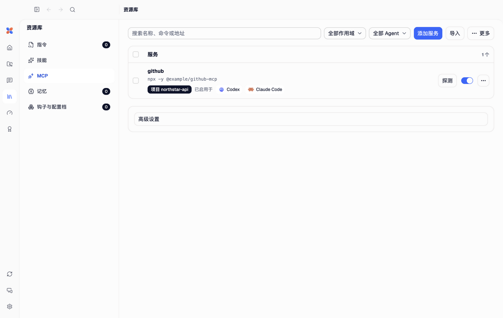
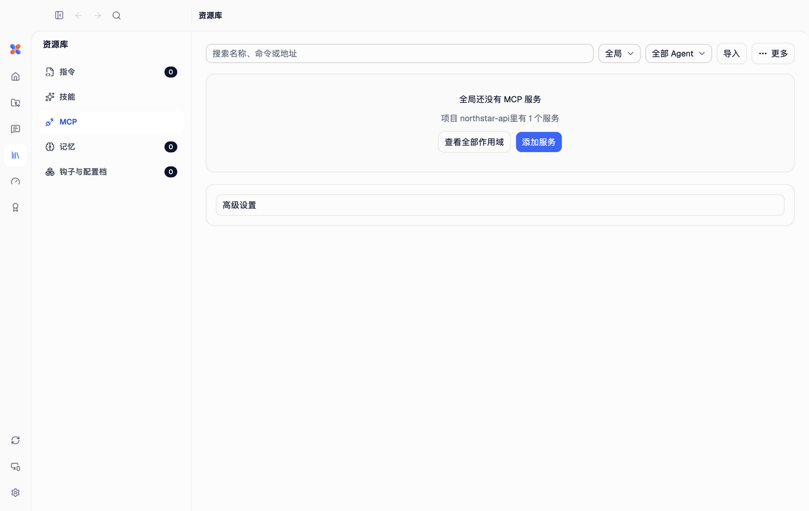

# v15 D 批界面验收截图

来自本轮 macOS arm64 Electron 合成沙盒，使用示例项目与 `/Users/demo` 路径；没有真实会话、账号、凭据或局域网地址

启动尺寸为 1360×860；四语与 1280×680 最小窗口的完整覆盖、导航、焦点和自动化测试结果见 [QA 记录](../../../qa/v15-d-library-agents-2026-10-22.md)

这些是实施后的七个指定状态；改动前的问题以本机只读设计清单为依据，不上传真实用户数据截图，也不复制 `designs/` 文件

## 技能库为空时默认展示使用位置

## 技能库空状态

## MCP 全部作用域

## MCP 全局空状态

## 设置中的 Claude Code

## 没有数据的 Codex

## 保留原有功能的集成标签

